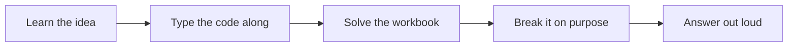
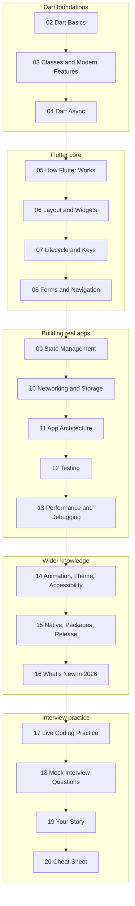
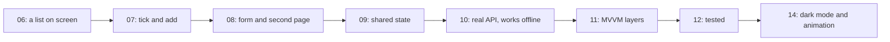

# Dart and Flutter 101

A free, hands-on guide to Dart and Flutter, written in plain language and aimed at getting you ready for a Flutter developer interview. It starts from `void main()` and ends with a tested app that talks to a real API.

You don't just read it. You type the code, solve problems that tests check for you, and break things on purpose so you recognise the errors later.

**Versions covered:** Flutter 3.47.9 and Dart 3.13.7.

## Quick start

You need [Flutter](https://docs.flutter.dev/get-started/install) and [VS Code](https://code.visualstudio.com).

```powershell
git clone https://github.com/Gaurav-py-Ghosh/Dart-and-Flutter-101.git
cd Dart-and-Flutter-101/flutter_interview_lab
flutter pub get
flutter test test
flutter run -d windows
```

Then open [note 01](notes/01-start-here.md), and work through the notes in order.

> [!NOTE]
> This guide was written and tested on Windows. The project includes Windows, Android and web. [Note 01](notes/01-start-here.md) explains how to add macOS or Linux, but that path hasn't been tested.

## What's in the repo

| Folder | What's inside |
|---|---|
| [`notes/`](notes/) | The guide itself: 20 notes, in order |
| [`flutter_interview_lab/`](flutter_interview_lab/) | The practice project: lessons, labs, workbooks, tests and answers |

## How every note works



## Your path



## The notes

All the notes in full take about 19 hours.

| Note | Time |
|---|---|
| [01 Start Here](notes/01-start-here.md) | 15 min |
| [02 Dart Basics](notes/02-dart-basics.md) | 90 min |
| [03 Dart Classes and Modern Features](notes/03-dart-classes-and-modern-features.md) | 90 min |
| [04 Dart Async](notes/04-dart-async.md) | 75 min |
| [05 How Flutter Works](notes/05-how-flutter-works.md) | 60 min |
| [06 Layout and Widgets](notes/06-layout-and-widgets.md) | 90 min |
| [07 Lifecycle and Keys](notes/07-lifecycle-and-keys.md) | 75 min |
| [08 Forms and Navigation](notes/08-forms-and-navigation.md) | 60 min |
| [09 State Management](notes/09-state-management.md) | 120 min |
| [10 Networking and Storage](notes/10-networking-and-storage.md) | 75 min |
| [11 App Architecture](notes/11-app-architecture.md) | 75 min |
| [12 Testing](notes/12-testing.md) | 60 min |
| [13 Performance and Debugging](notes/13-performance-and-debugging.md) | 60 min |
| [14 Animation Theme and Accessibility](notes/14-animation-theme-and-accessibility.md) | 45 min |
| [15 Native Packages and Release](notes/15-native-packages-and-release.md) | 45 min |
| [16 Whats New in 2026](notes/16-whats-new-in-2026.md) | 10 min |
| [17 Live Coding Practice](notes/17-live-coding-practice.md) | 60 min |
| [18 Mock Interview Questions](notes/18-mock-interview-questions.md) | 40 min |
| [19 Your Story](notes/19-your-story.md) | 30 min |
| [20 Interview Day Cheat Sheet](notes/20-interview-day-cheat-sheet.md) | 30 min |

### Short on time?

Don't rush through everything. Cut in this order:

1. Drop the workbooks, but keep My Tasks and "Test yourself".
2. In note 12, read the Learn part only, and skip writing tests.
3. If you're still behind, protect notes 05, 07, 09, 11 and 19.

## What you'll build

Across the notes you build **My Tasks**, a real app that grows with each stage:



Every stage has a finished version in `lib/workbook_answers/tasks_app/`, so you can compare your code or catch up.

## Commands

Run these inside `flutter_interview_lab/`:

| I want to | Command |
|---|---|
| Run a Dart lesson | `dart run bin/d01_basics.dart` |
| Open the 14 labs | `flutter run -d windows` |
| **Run my My Tasks app** | `flutter run -d windows -t lib/my_app/main.dart` |
| **Check a workbook** | `flutter test workbook_test/w02_test.dart` |
| **Check one workbook problem** | `flutter test workbook_test/w02_test.dart --plain-name "1 total"` |
| See the finished My Tasks | `flutter run -d windows -t lib/workbook_answers/tasks_app/stage11.dart` |
| Apply a code change while it's running | Press `r` (reload) or `R` (restart) |
| Run the lab's tests | `flutter test test` |
| Run the coding challenges | `flutter test challenge_test` |
| Test the real app | `flutter test integration_test -d windows` |
| Check code quality | `flutter analyze` |

> [!IMPORTANT]
> `workbook_test` and `challenge_test` **fail until you solve the problems**. That's how they're meant to work. Answers are in `lib/workbook_answers/` and `lib/solutions/`.

## Which practice goes with which note

| Note | My Tasks stage | Workbook | Lab in the app |
|---|---|---|---|
| [02 Dart Basics](notes/02-dart-basics.md) | | `w02`, 10 problems | |
| [03 Dart Classes and Modern Features](notes/03-dart-classes-and-modern-features.md) | | `w03`, 9 problems | |
| [04 Dart Async](notes/04-dart-async.md) | | `w04`, 8 problems | |
| [05 How Flutter Works](notes/05-how-flutter-works.md) | Your first app | | 2 |
| [06 Layout and Widgets](notes/06-layout-and-widgets.md) | 1: a list | `w06`, 6 problems | 1 |
| [07 Lifecycle and Keys](notes/07-lifecycle-and-keys.md) | 2: tick and add | `w07`, 7 problems | 2, 3 |
| [08 Forms and Navigation](notes/08-forms-and-navigation.md) | 3: form and pages | `w08`, 7 problems | 4, 5, 6 |
| [09 State Management](notes/09-state-management.md) | 4: Provider | `w09`, 8 problems | 7 |
| [10 Networking and Storage](notes/10-networking-and-storage.md) | 5: real API | `w10`, 7 problems | 8, 9, 10 |
| [11 App Architecture](notes/11-app-architecture.md) | 6: MVVM | `w11`, 3 problems | 9 |
| [12 Testing](notes/12-testing.md) | Its tests | `w12`, 6 tests to write | |
| [13 Performance and Debugging](notes/13-performance-and-debugging.md) | Faster parsing | `w13`, 3 problems | 12 |
| [14 Animation Theme and Accessibility](notes/14-animation-theme-and-accessibility.md) | Dark mode, animation | `w14`, 5 problems | 11 |
| [15 Native Packages and Release](notes/15-native-packages-and-release.md) | An asset, a release build | `w15`, 3 problems | 13 |
| [17 Live Coding Practice](notes/17-live-coding-practice.md) | From a blank file | `challenges`, 10 problems | 14 |

## Official sources

| What | Link |
|---|---|
| Flutter docs | https://docs.flutter.dev |
| Flutter API reference | https://api.flutter.dev |
| Flutter architecture guide | https://docs.flutter.dev/app-architecture |
| Dart docs | https://dart.dev/docs |
| Dart API reference | https://api.dart.dev |
| Try code in the browser | https://dartpad.dev |
| Packages | https://pub.dev |
| Videos | https://www.youtube.com/@flutterdev |
