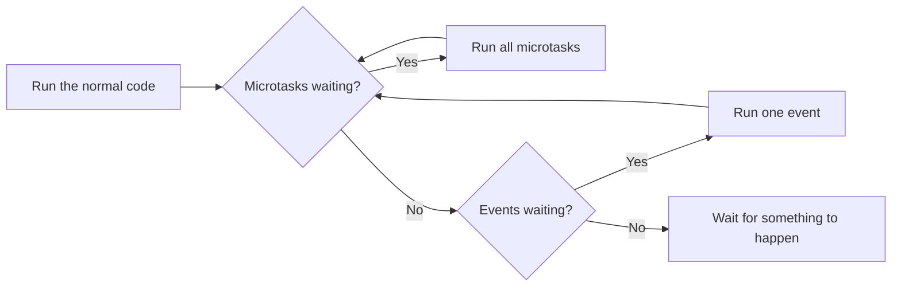

[Guide home](../README.md) · Back: [03 Dart Classes and Modern Features](03-dart-classes-and-modern-features.md) · Next: [05 How Flutter Works](05-how-flutter-works.md)

# Dart Async

**Why this matters:** every real app waits for something: a server, a file, a database. "Future vs Stream" and "async vs isolate" come up in almost every interview.

**See it working:** `dart run bin/d03_async.dart`

---

# Part 1: Learn

## 1. The problem

Say a network call takes 3 seconds. If your code just stopped and waited, **the whole app would freeze**: no scrolling, and no tapping. So we need a way to say "start this, carry on with other things, and come back when it's ready".

## 2. One worker and a to-do list

Dart runs your code using **one worker**, inside one **isolate**. It only does one thing at a time. It stays responsive by following a routine, called the **event loop**:



There are two to-do lists:

| Queue | What's in it | Priority |
|---|---|---|
| **Microtask queue** | Small urgent jobs, like a finished Future's `.then` | First |
| **Event queue** | Everything else: taps, timers, network replies, `Future(() => ...)` | After all microtasks |

**The classic question:** what does this print?

```dart
print('1 normal code');
Future(() => print('5 event queue'));
scheduleMicrotask(() => print('3 microtask queue'));
Future.value().then((_) => print('4 then on a finished Future'));
print('2 normal code again');
```

The number in each message is the actual order. Normal code finishes first (1, 2). Then the microtasks run in the order they were added (3, 4). Then the event (5).

> **Rule: normal code, then microtasks, then events.**

## 3. Future: one answer, later

A `Future` is like a **restaurant buzzer**. You get it right away, and it goes off when your order is ready. It's in one of these states:

| State | Meaning |
|---|---|
| Uncompleted | Still cooking |
| Completed with a value | Your food's ready |
| Completed with an error | The kitchen ran out |

`Future<String>` means "later, you'll get a `String`".

```dart
Future<String> fetchName() async {
  await Future.delayed(const Duration(milliseconds: 100));
  return 'Asha';
}
```

Line by line:

- `Future<String>`: this function promises a String, later.
- `async`: this function can use `await`, and it always returns a Future.
- `await`: **pause this function** until that's ready. It doesn't freeze the app, as the worker goes off to do other jobs.
- `return 'Asha'`: this completes the Future.

Using it:

```dart
final name = await fetchName();  // name is a String
print(name);
```

**What if you forget `await`?**

```dart
final name = fetchName();  // name is a Future<String>, not a String!
print(name);               // Instance of 'Future<String>'
```

That's the most common beginner mistake.

**The older style, using `.then`.** You'll see this in existing code. `await` does the same thing, and it's easier to read.

```dart
fetchName().then((name) => print(name)).catchError((e) => print(e));
```

## 4. Handling errors

Use normal `try` and `catch`, with `await`:

```dart
try {
  final data = await fetchData();
  print(data);
} catch (e) {
  print('Failed: $e');
} finally {
  print('Always runs: hide the spinner here');
}
```

**You must `await` inside the `try`.** If you don't, the function moves on, and the error arrives after the `try` has already finished, so nothing catches it.

## 5. One by one, or all together

```dart
await fetchName();
await fetchName();                                // about 200 ms in total

await Future.wait([fetchName(), fetchName()]);    // about 100 ms in total
```

`Future.wait` starts them all together, and waits for all of them. It's for jobs that don't depend on each other, such as loading a profile and a menu for the same screen. If any one fails, the whole thing fails.

## 6. Timeouts

```dart
try {
  await fetchName().timeout(const Duration(seconds: 5));
} on TimeoutException {
  print('Too slow');
}
```

`TimeoutException` comes from `dart:async`, so you need `import 'dart:async';`.

## 7. Stream: many answers over time

A Future is **one parcel**. A Stream is a **conveyor belt**: it can bring many values over time. Examples are chat messages, location updates, and download progress.

**Creating one, using `async*` and `yield`:**

```dart
Stream<int> countTo(int max) async* {
  for (var i = 1; i <= max; i++) {
    await Future.delayed(const Duration(milliseconds: 20));
    yield i;   // send out a value, and carry on
  }
}
```

**Compare:** `return` finishes a function, and gives one value. `yield` gives a value, and **keeps going**.

**Reading one, using `await for`:**

```dart
await for (final n in countTo(3)) {
  print(n);
}
```

**Or using `listen`:**

```dart
final subscription = countTo(3).listen(
  (n) => print(n),
  onError: (e) => print('Error: $e'),
  onDone: () => print('Finished'),
);
```

Streams have the same tools as lists:

```dart
final squares = await countTo(4)
    .where((n) => n.isEven)
    .map((n) => n * n)
    .toList();
```

### Sending your own values: StreamController

A controller is a stream with a handle, so that you can push values in yourself:

```dart
final controller = StreamController<String>();
controller.stream.listen((message) => print(message));
controller.add('Hello');
await controller.close();
```

### Single vs broadcast

| | Single-subscription | Broadcast |
|---|---|---|
| Listeners | One | Many |
| Like | A private phone call | A radio station |
| Late listeners | Get what's buffered | Miss what's already gone |
| Make one with | `StreamController()` | `StreamController.broadcast()` |

### Clean up!

A subscription keeps running until you stop it. If a widget forgets, you've got a **memory leak**, and maybe a crash. Do this in `dispose()`:

```dart
await subscription.cancel();
await controller.close();
```

## 8. Isolates: a second worker

**`async` is not parallel.** It's still one worker switching between jobs. That works when you're *waiting*, as the worker is free to do something else.

But heavy **calculation** keeps the worker busy. It can't switch away, so the app freezes.

```dart
// This freezes the app, even though it's async!
Future<int> slow() async {
  var total = 0;
  for (var i = 0; i < 10000000000; i++) {
    total += i;
  }
  return total;
}
```

An **isolate** is a second worker with **its own memory**. Isolates can't share variables. They only send each other messages, so they can't corrupt each other's data, and you don't need locks.

```dart
final result = await Isolate.run(() => heavySum(100000000));
```

In Flutter, `compute(function, value)` does the same thing on mobile and desktop.

| Use | When | Example |
|---|---|---|
| `async/await` | **Waiting** for something | Network, files, database |
| Isolate | **Heavy calculation** | Parsing huge JSON, resizing images |

> [!WARNING]
> **Limits worth knowing**
>
> - The web doesn't support isolates. There, `compute` runs on the main thread, so it can still freeze the page.
> - You can't update widgets from a spawned isolate, or read assets using `rootBundle`.
> - Global variables are copied, not shared.

---

# Part 2: Code along

**Build a pretend food delivery flow.** Type it in a new file, `bin/my_delivery.dart`.

**Step 1: Fake some slow network calls.**

```dart
import 'dart:async';
import 'dart:isolate';

Future<String> fetchUser() async {
  await Future.delayed(const Duration(milliseconds: 200));
  return 'Asha';
}

Future<List<String>> fetchMenu() async {
  await Future.delayed(const Duration(milliseconds: 200));
  return ['Pizza', 'Tea'];
}

Future<String> placeOrder(String item) async {
  await Future.delayed(const Duration(milliseconds: 100));
  if (item == 'Tea') throw Exception('Tea is sold out');
  return 'Order placed for $item';
}
```

**Step 2: A stream that tracks the order, and some heavy work.**

```dart
Stream<String> trackOrder() async* {
  const steps = ['Cooking', 'On the way', 'Delivered'];
  for (final step in steps) {
    await Future.delayed(const Duration(milliseconds: 100));
    yield step;
  }
}

int countSteps(int upTo) {
  var total = 0;
  for (var i = 0; i < upTo; i++) {
    total += i % 2;
  }
  return total;
}
```

**Step 3: Use everything.** Note that `main` is `async` as well.

```dart
Future<void> main() async {
  print('1. Start');

  final watch = Stopwatch()..start();
  final results = await Future.wait([fetchUser(), fetchMenu()]);
  final user = results[0] as String;
  final menu = results[1] as List<String>;
  print('2. $user sees $menu, in about 200 ms: ${watch.elapsedMilliseconds < 350}');

  print('3. ${await placeOrder('Pizza')}');

  try {
    print(await placeOrder('Tea'));
  } catch (error) {
    print('4. Handled: $error');
  }

  await for (final step in trackOrder()) {
    print('5. Status: $step');
  }

  final controller = StreamController<int>.broadcast();
  final subscription = controller.stream.listen((n) => print('6. Got $n'));
  controller.add(1);
  controller.add(2);
  await Future.delayed(Duration.zero);
  await subscription.cancel();
  await controller.close();

  final total = await Isolate.run(() => countSteps(1000000));
  print('7. From another isolate: $total');

  print('8. End');
}
```

Run it using `dart run bin/my_delivery.dart`.

**You should see exactly this:**

```text
1. Start
2. Asha sees [Pizza, Tea], in about 200 ms: true
3. Order placed for Pizza
4. Handled: Exception: Tea is sold out
5. Status: Cooking
5. Status: On the way
5. Status: Delivered
6. Got 1
6. Got 2
7. From another isolate: 500000
8. End
```

**Now change it yourself:**

- [ ] Remove `await` before `placeOrder('Pizza')`. What prints instead?
- [ ] Remove `await` before `placeOrder('Tea')`. The `catch` no longer catches it. Why?
- [ ] Add a `.timeout()` to `fetchUser()` that's too short, and handle it.
- [ ] Replace `await for` with `.listen`. Notice how `8. End` can now print before the status lines.

---

# Part 3: Workbook

**Open:** `lib/workbook/w04.dart`

**Check:** `flutter test workbook_test/w04_test.dart`

- [ ] 1 `addLater`: `async`, `await`, `Future.delayed`
- [ ] 2 `fetchOrFallback`: `try` and `catch` with `await`
- [ ] 3 `totalLength`: `Future.wait`. The test checks that they really run together
- [ ] 4 `withinOneSecond`: `.timeout` and `TimeoutException`
- [ ] 5 `countDown`: `async*` and `yield`
- [ ] 6 `sumStream`: `await for`
- [ ] 7 `onlyLong`: `where` and `map` on a stream
- [ ] 8 `countPrimesInBackground`: `Isolate.run`

---

# Part 4: Break it on purpose

Using `bin/d03_async.dart`, run it after each change:

- [ ] Change the timeout from `10` to `500` milliseconds. The "timed out" message goes away.
- [ ] Remove the `await` before `failing()`. The `try/catch` no longer catches the error, and the program stops with it.
- [ ] Remove `.broadcast()` from the `StreamController`. The second `listen` now throws an error.
- [ ] Write down the print order for `eventLoopOrder`, then swap the `Future(...)` and `scheduleMicrotask(...)` lines. The output order doesn't change.

---

# Part 5: Test yourself

<details>
<summary>Future vs Stream?</summary>

A Future delivers one result later. A Stream delivers many results over time. Use a Future for one API call, and a Stream for live data like chat messages.

</details>

<details>
<summary>Is Dart single-threaded? Then how does async work?</summary>

Each isolate runs one thread with an event loop. When code hits `await`, that function pauses and the thread picks up other work. The function resumes when its result arrives. It's taking turns, not doing two things at the same moment.

</details>

<details>
<summary>What does <code>await</code> actually do?</summary>

It pauses the current function, not the whole app, until the Future finishes. Then it gives you the value, or throws the error so that `try/catch` can handle it.

</details>

<details>
<summary>What happens if you forget <code>await</code>?</summary>

You get the Future itself, rather than its value, and the code carries on immediately. Any error escapes your `try/catch`.

</details>

<details>
<summary>Microtask queue vs event queue?</summary>

After normal code finishes, Dart runs all microtasks, then one event, and then checks for microtasks again. So microtasks always go first. Timers and taps are events. A `.then` on a finished Future is a microtask.

</details>

<details>
<summary>When would you use an isolate instead of async?</summary>

When the work is heavy calculation rather than waiting. An example is parsing a huge JSON file, which would freeze the UI. Async only helps when you're waiting on something else, like a server.

</details>

<details>
<summary>Does making a function <code>async</code> stop it freezing the app?</summary>

No. `async` doesn't move work to another thread. A heavy loop inside an async function still blocks the worker. Only the waiting at an `await` frees it. For heavy work, use an isolate.

</details>

<details>
<summary>Why don't isolates share memory?</summary>

It avoids a whole class of bugs that happen when two threads edit the same data at once. They send messages instead, so Dart doesn't need locks for your objects.

</details>

<details>
<summary><code>Future.wait</code> vs awaiting one by one?</summary>

`Future.wait` starts all the jobs together and finishes when all are done, so the total time is about the slowest job. Awaiting one by one adds the times up. Use it only when jobs don't depend on each other. By default it fails if any one job fails.

</details>

<details>
<summary>Single-subscription vs broadcast stream?</summary>

A single-subscription stream allows one listener. A broadcast stream allows many, but a listener who joins late misses past values.

</details>

<details>
<summary><code>async</code> vs <code>async*</code>, and <code>return</code> vs <code>yield</code>?</summary>

`async` returns a Future, with one value, using `return`. `async*` returns a Stream, sending many values using `yield`, and it keeps running after each one.

</details>

<details>
<summary>Why must you cancel a stream subscription?</summary>

It holds on to memory and keeps running, even after the screen has gone. It can cause leaks, and errors such as `setState() called after dispose()`. Cancel it in `dispose`.

</details>

# Done when

- [ ] You can draw the event loop, and predict the print order
- [ ] You can explain async vs isolate in two sentences
- [ ] You typed the delivery flow, and it printed the right output
- [ ] At least 6 of 8 workbook tests pass

**Then get some sleep.** Sleep is when this sticks.

Next: [05 How Flutter Works](05-how-flutter-works.md)
