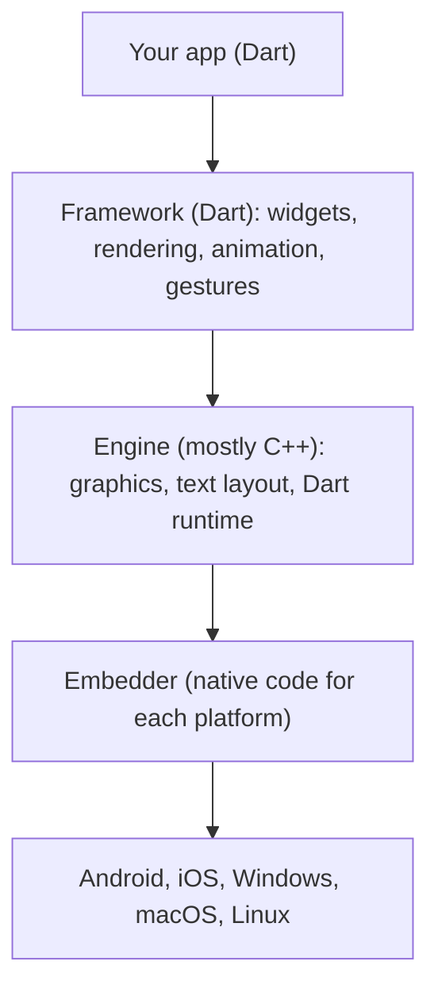
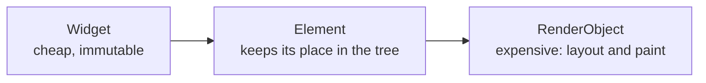
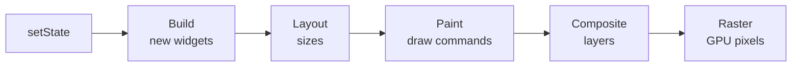

[Guide home](../README.md) · Back: [04 Dart Async](04-dart-async.md) · Next: [06 Layout and Widgets](06-layout-and-widgets.md)

# How Flutter Works

**Why this matters:** this is what separates someone who has followed tutorials from someone who understands Flutter. Spend real time here.

---

# Part 1: Learn

## 1. The big idea

Most cross-platform tools ask the phone to draw its own buttons. **Flutter draws every pixel itself**, like a game engine does. That's why an app looks the same on every device, and why it needs its own engine.

## 2. Declarative UI: describe it, don't change it

In older UI systems, you find a label and change it:

```text
label.setText("5")     // imperative: step by step commands
```

In Flutter, you describe **what the screen should look like for the current data**. When the data changes, you describe it again, and Flutter works out what's different.

```dart
Text('Taps: $_count')  // declarative: the result of the data
```

> **UI = f(state)**
> The screen is the result of a function that takes your data.

So you never say "change this label". You change the data, and Flutter redraws.

## 3. Everything is a widget

A **widget** is a small, immutable **description** of part of the screen. It's not the actual pixels. Even things like padding and centering are widgets, and you build screens by nesting them inside each other.

```dart
Center(
  child: Padding(
    padding: const EdgeInsets.all(8),
    child: Text('Hello'),
  ),
)
```

Every widget has a `build` method that returns more widgets, all the way down.

| Widget type | Has its own changing data? | Example |
|---|---|---|
| `StatelessWidget` | No | A label |
| `StatefulWidget` | Yes | A checkbox |
| `InheritedWidget` | Passes data down the tree | `Theme` |
| `RenderObjectWidget` | Does real layout and painting | `Padding`, `Row` |

The first three are in [07 Lifecycle and Keys](07-lifecycle-and-keys.md) and [09 State Management](09-state-management.md).

## 4. The layers



| Layer | Written in | Job |
|---|---|---|
| **Framework** | Dart | The widgets you use. You can read its source code |
| **Engine** | Mostly C++ | Draws the pixels, lays out text, and runs Dart |
| **Embedder** | Kotlin/Java, Swift/Objective-C, C++ | The small native app that hosts Flutter on each platform |

## 5. The three trees

This is the most important idea in this note. Think of building a house:

| Tree | Like | Lifespan | Job |
|---|---|---|---|
| **Widget** | The blueprint | Thrown away and recreated all the time | Describes what you want |
| **Element** | The site manager | Stays around | Links the blueprint to the real thing, and holds `State` |
| **RenderObject** | The actual house | Stays around | Does the sizing, painting and hit testing |



When you rebuild, Flutter creates a new blueprint. The site manager compares it with the old one:

- **Same widget type and same key?** Keep the element and the house, and just update what changed.
- **Different?** Tear that part down, and build it again.

**That's why rebuilding is cheap.** Widgets are only small descriptions. The expensive objects are reused whenever possible.

## 6. BuildContext

Every `build` method receives a `BuildContext`. **It's the element**: the widget's address in the tree.

It's how a widget looks upward. `Theme.of(context)` walks up from this location to find the nearest `Theme`.

**The common bug:** a context can only see what's **above** it. In this code, `context` is above the `MaterialApp`, so it can't find a Navigator:

```dart
class MyApp extends StatelessWidget {
  @override
  Widget build(BuildContext context) {
    return MaterialApp(
      home: TextButton(
        onPressed: () => Navigator.of(context).pop(), // wrong context!
        child: const Text('Back'),
      ),
    );
  }
}
```

The fix is to use a context from below it, with a child widget or a `Builder`:

```dart
home: Builder(
  builder: (innerContext) => TextButton(
    onPressed: () => Navigator.of(innerContext).pop(),
    child: const Text('Back'),
  ),
),
```

## 7. From a change to the screen



| Step | What happens |
|---|---|
| **Build** | `build()` runs, and elements get updated |
| **Layout** | Each render object works out its size. Constraints go down, sizes come up, in a single pass |
| **Paint** | Each one records its drawing commands |
| **Composite** | The layers get put together into a scene |
| **Raster** | The GPU turns it into pixels |

At 60 frames a second, you have **16 ms per frame**. At 120 you have about 8 ms. Miss that budget and the user sees a stutter, called **jank**.

| Thread | Job |
|---|---|
| **UI** | Runs your Dart code: build, layout, paint commands |
| **Raster** | Turns those commands into pixels on the GPU |
| **Platform** | The native side. Since Flutter 3.29, the UI and platform threads are merged on iOS and Android |

## 8. How Dart gets compiled

| Term | Meaning | Good for |
|---|---|---|
| **JIT** (just in time) | Compiled while the app runs | Fast development, and hot reload |
| **AOT** (ahead of time) | Compiled into machine code in advance | Fast startup, and smooth running |

| Mode | Compiled with | Used for | Hot reload | Command |
|---|---|---|---|---|
| **Debug** | JIT | Daily coding | Yes | `flutter run` |
| **Profile** | AOT | Measuring performance | No | `flutter run --profile` |
| **Release** | AOT | Shipping to users | No | `flutter run --release` |

Profile and release modes need a real device, not an emulator. Never judge performance in debug mode, because it's slow on purpose.

On the web, Dart compiles to JavaScript or WebAssembly.

**Why does Flutter use Dart?** This is why the two fit together so well:

- **Both JIT and AOT:** JIT gives hot reload while you develop, and AOT gives fast native code for users. Few languages do both well.
- **Sound null safety:** a whole class of crashes is caught before the app runs.
- **Fast garbage collection:** it suits Flutter creating and discarding many small widgets.
- **Single-threaded by default:** there are no locks to manage, so UI code is simpler, and isolates handle heavy work.

## 9. Hot reload vs hot restart

| | Hot reload (`r`) | Hot restart (`R`) | Full restart |
|---|---|---|---|
| Keeps state | Yes | No | No |
| Re-runs `main()` | No | Yes | Yes |
| Picks up native changes | No | No | Yes |

Hot reload injects your new code, and rebuilds the widgets. `initState` doesn't run again, so a change you make there needs a restart.

## 10. Impeller

Impeller is Flutter's own rendering engine. It prepares its shaders ahead of time, which removes the stutter you could see the first time an effect ran.

| Platform | Status |
|---|---|
| iOS | Default, and the only option |
| Android | Default on API 29+ with Vulkan. Others fall back to OpenGL |
| Windows, macOS, Linux | Default as of Flutter 3.47 |
| Web | Not used |

---

# Part 2: Code along

**Build your first app from an empty file.** This is your first time typing Flutter, so go slowly.

**Step 1.** Create a new file, `lib/my_app/first.dart`, and type this:

```dart
import 'package:flutter/material.dart';

void main() {
  runApp(const FirstApp());
}

class FirstApp extends StatelessWidget {
  const FirstApp({super.key});

  @override
  Widget build(BuildContext context) {
    return const MaterialApp(home: Text('Hello'));
  }
}
```

Line by line:

| Line | Meaning |
|---|---|
| `import ...material.dart` | Brings in Flutter's widgets |
| `runApp(...)` | Starts Flutter, and makes this widget the root |
| `extends StatelessWidget` | This widget has no changing data of its own |
| `const FirstApp({super.key})` | The constructor. `super.key` passes a key to the parent class |
| `@override build` | Flutter calls this to find out what to draw |
| `MaterialApp` | Sets up the theme, navigation and more for the whole app |

**Step 2.** Run this exact file. `-t` means "start from this file":

```powershell
flutter run -d windows -t lib/my_app/first.dart
```

You'll see small, plain text. Leave it running.

**Step 3.** Replace the `FirstApp` build, and add the two classes below. Then save, and press `r`:

```dart
  @override
  Widget build(BuildContext context) {
    return const MaterialApp(home: HomeScreen());
  }
}

class HomeScreen extends StatefulWidget {
  const HomeScreen({super.key});

  @override
  State<HomeScreen> createState() => _HomeScreenState();
}

class _HomeScreenState extends State<HomeScreen> {
  int _count = 0;

  @override
  Widget build(BuildContext context) {
    print('HomeScreen build: count is $_count');
    return Scaffold(
      appBar: AppBar(title: const Text('My first app')),
      body: Center(
        child: Column(
          mainAxisSize: MainAxisSize.min,
          children: [
            Text('Taps: $_count'),
            const NormalLabel(),
            const SizedBox(height: 12),
            FilledButton(
              onPressed: () => setState(() => _count++),
              child: const Text('Tap me'),
            ),
          ],
        ),
      ),
    );
  }
}

class NormalLabel extends StatelessWidget {
  const NormalLabel({super.key});

  @override
  Widget build(BuildContext context) {
    print('NormalLabel build');
    return const Text('I never change');
  }
}
```

Press `R`, because you changed how the app starts up.

**Step 4: Watch the terminal.** Tap the button a few times.

- `HomeScreen build` prints on **every tap**, as `setState` rebuilds that widget.
- `NormalLabel build` prints **only once**, even though it's inside `HomeScreen`.

**Step 5: See why `const` matters.** Remove `const` from `const NormalLabel()`, save, and press `r`. Now tap again. `NormalLabel build` prints on **every tap**.

You've just proven what `const` does. A `const` widget is the same object each time, so Flutter skips it.

**Now change it yourself:**

- [ ] Add a second button that subtracts 1.
- [ ] Change the `Text` to red when the count is above 5.
- [ ] Change `_count = 0` to `_count = 10`, and press `r`. Nothing changes. Press `R`, and it does. **That's reload vs restart.**

If you get stuck, compare with `lib/workbook_answers/tasks_app/stage05.dart`.

**More to try in the labs:**

- [ ] Run `flutter run -d windows`, open lab 2 (Lifecycle), and press the buttons. Watch which methods run and when.
- [ ] Open DevTools using the link the terminal prints, and look at the widget tree in Inspector.

---

# Part 3: Test yourself

<details>
<summary>How does Flutter differ from React Native?</summary>

Flutter draws everything itself using its own engine, so it looks the same on every device, and it compiles to native machine code. React Native uses the platform's real native components, controlled from JavaScript. So React Native looks native automatically, while Flutter gives you more consistency and control over every pixel.

</details>

<details>
<summary>What does declarative UI mean?</summary>

You describe what the screen should look like for the current state, rather than giving step-by-step commands to change it. When state changes, Flutter rebuilds that description and works out what changed. In short: UI is a function of state.

</details>

<details>
<summary>Explain the three trees.</summary>

The widget tree is a set of cheap, immutable descriptions that get recreated all the time. The element tree stays around and connects each widget to its place on screen, and it holds State. The render tree does the expensive layout and painting. On a rebuild, Flutter compares new widgets to the elements, and reuses what it can.

</details>

<details>
<summary>If widgets get rebuilt constantly, why is Flutter fast?</summary>

Widgets are only small descriptions, so creating them is cheap. Elements and render objects are reused if the widget type and key match, so the expensive work happens only for what really changed. Layout also runs in a single pass, in O(n) time.

</details>

<details>
<summary>What is BuildContext?</summary>

It's the widget's location in the tree. Technically, it's the Element. Methods like `Theme.of(context)` use it to walk up the tree to find something. A common bug is using a context that's above the thing you're looking for.

</details>

<details>
<summary>What are Flutter's layers?</summary>

The framework, in Dart, holds the widgets. The engine, mostly C++, does the drawing and runs Dart. The embedder is native code that hosts Flutter on each platform.

</details>

<details>
<summary>Walk me through what happens after <code>setState</code>.</summary>

The element is marked dirty, and a new frame is scheduled. In that frame, `build` runs and elements update. Then layout works out sizes, paint records the drawing commands, those are composited into layers, and the raster thread turns them into pixels on the GPU.

</details>

<details>
<summary>Hot reload vs hot restart?</summary>

Hot reload injects changed code and rebuilds while keeping state. Hot restart resets the app and runs `main()` again, so state is lost. Hot reload doesn't re-run `initState`, `main`, or field initialisers for existing objects.

</details>

<details>
<summary>JIT vs AOT?</summary>

JIT compiles while the app runs. That allows hot reload, so it's used in debug. AOT compiles ahead of time into machine code, giving fast startup and smooth performance, so it's used in profile and release.

</details>

<details>
<summary>Debug vs profile vs release?</summary>

Debug has hot reload and extra checks, and is slow. Profile performs close to release, but still connects to DevTools, so it's for measuring. Release is fully optimised for users. Profile and release need a real device.

</details>

<details>
<summary>What is jank, and what's the frame budget?</summary>

Jank is a visible stutter from missing a frame. The budget is 16 ms per frame at 60 Hz, and about 8 ms at 120 Hz.

</details>

<details>
<summary>What is Impeller, and why was it built?</summary>

It's Flutter's rendering engine. It compiles its shaders ahead of time, instead of during animations, which removes first-run shader stutter. It's the default on iOS, modern Android and, since 3.47, desktop.

</details>

# Done when

- [ ] You can draw the three trees and explain them without looking
- [ ] You can name the pipeline steps and the frame budget
- [ ] You typed your first app, and saw `const` stop a rebuild
- [ ] You saw the difference between reload and restart

Next: [06 Layout and Widgets](06-layout-and-widgets.md)
