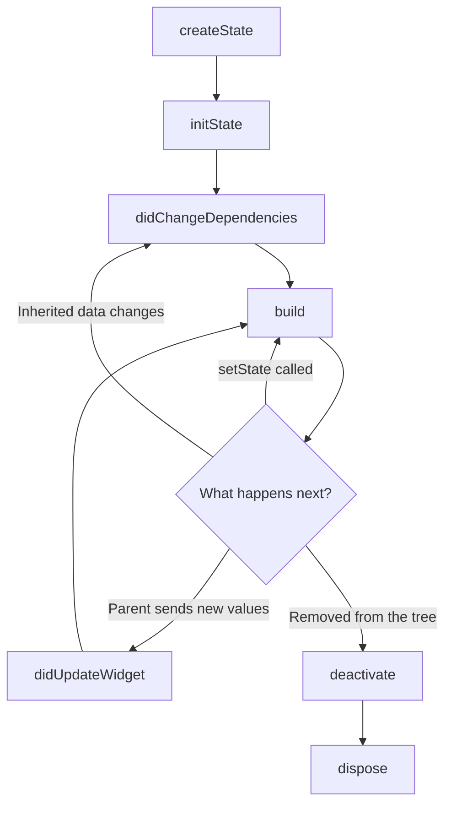

[Guide home](../README.md) · Back: [06 Layout and Widgets](06-layout-and-widgets.md) · Next: [08 Forms and Navigation](08-forms-and-navigation.md)

# Lifecycle and Keys

**Why this matters:** the State lifecycle is asked in nearly every Flutter interview. Keys are where interviewers check for real depth.

**See it working:** `flutter run -d windows`, then open labs 2 and 3. The code's in `lib/labs/ui_labs.dart`.

---

# Part 1: Learn

## 1. Stateless vs Stateful

| | `StatelessWidget` | `StatefulWidget` |
|---|---|---|
| Has its own changing data | No | Yes, kept in a `State` object |
| Redraws when | Its parent gives it new values | Same, or when it calls `setState` |
| Example | A label | A checkbox, or a form |

**Stateless** has one class:

```dart
class Greeting extends StatelessWidget {
  const Greeting({super.key, required this.name});
  final String name;

  @override
  Widget build(BuildContext context) => Text('Hello $name');
}
```

**Stateful** has two classes:

```dart
class TapCounter extends StatefulWidget {         // 1. The widget: immutable settings
  const TapCounter({super.key, required this.label});
  final String label;

  @override
  State<TapCounter> createState() => _TapCounterState();
}

class _TapCounterState extends State<TapCounter> { // 2. The state: stays alive
  int _count = 0;

  @override
  Widget build(BuildContext context) {
    return TextButton(
      onPressed: () => setState(() => _count++),
      child: Text('${widget.label}: $_count'),     // read settings using widget.
    );
  }
}
```

**Why two objects?** Remember [05 How Flutter Works](05-how-flutter-works.md). Widgets are immutable, and get thrown away all the time. If `_count` lived there, it would be lost on each rebuild. The `State` object is held by the element, so it **survives**.

`widget.label` is how the state reads values from its widget.

## 2. What setState really does

```dart
setState(() => _count++);
```

1. It runs your function straight away.
2. It marks this widget as "dirty", meaning it needs rebuilding.
3. Flutter rebuilds it on the **next frame**, not instantly.

So calling it three times before the next frame still gives **one** rebuild.

It rebuilds this widget and its children, but not its parents. So **call it as low in the tree as you can**.

## 3. The lifecycle



| Method | Runs | Use it to |
|---|---|---|
| `createState` | Once | Create the State object, and nothing else |
| `initState` | Once | Create controllers, start listeners, start loading |
| `didChangeDependencies` | After `initState`, and when inherited data changes | Read things like `Theme.of(context)` |
| `build` | Many times | Describe the UI. **Keep it fast, with no side effects** |
| `didUpdateWidget` | When the parent sends new values | React to a changed value, such as restarting a request |
| `setState` | When you call it | Mark this widget as needing a rebuild |
| `deactivate` | When removed from the tree | Rarely needed |
| `dispose` | Once, at the end | **Clean up** controllers, timers and subscriptions |

**In code:**

```dart
class _LifecycleChildState extends State<LifecycleChild> {
  @override
  void initState() {
    super.initState();                // call this FIRST
    // set things up here
  }

  @override
  void didChangeDependencies() {
    super.didChangeDependencies();
    // safe to read Theme.of(context) here
  }

  @override
  void didUpdateWidget(LifecycleChild oldWidget) {
    super.didUpdateWidget(oldWidget);
    if (oldWidget.value != widget.value) {
      // the parent sent a new value
    }
  }

  @override
  void dispose() {
    // clean up here
    super.dispose();                  // call this LAST
  }

  @override
  Widget build(BuildContext context) => const SizedBox();
}
```

## 4. Four rules that stop real bugs

**Rule 1: Dispose what you create.** `TextEditingController`, `AnimationController`, `ScrollController`, `FocusNode`, `Timer`, `StreamSubscription`. If you don't, you leak memory.

```dart
final _controller = TextEditingController();

@override
void dispose() {
  _controller.dispose();
  super.dispose();
}
```

**Rule 2: Check `mounted` after `await`.** The screen may have closed while you were waiting.

```dart
Future<void> _start() async {
  final result = await widget.load();
  if (!mounted) return;                 // the widget might be gone
  setState(() => _text = result);
}
```

If you skip this, you get `setState() called after dispose()`. The same goes for using `context` after an `await`.

**Rule 3: Don't read `Theme.of(context)` in `initState`.** Inherited lookups aren't ready. Use `didChangeDependencies`.

**Rule 4: Don't start work in `build`.** It runs many times, so a network call there would run many times too.

## 5. TextEditingController and Timer

These two come up all the time, and both need `dispose`.

**TextEditingController** reads and sets a text field's value:

```dart
final _controller = TextEditingController();

TextField(controller: _controller)

_controller.text;      // read it
_controller.clear();   // clear it
```

**Timer** runs something later, or repeatedly. It needs `import 'dart:async';`.

```dart
Timer? _timer;

@override
void initState() {
  super.initState();
  _timer = Timer.periodic(const Duration(seconds: 1), (timer) {
    setState(() => _left--);
    if (_left == 0) timer.cancel();
  });
}

@override
void dispose() {
  _timer?.cancel();
  super.dispose();
}
```

## 6. The app's own lifecycle

This is different. It tracks the **whole app**, such as going to the background:

```dart
late final AppLifecycleListener _listener = AppLifecycleListener(
  onPause: () => print('App went to the background'),
  onResume: () => print('App came back'),
);
```

| State | Meaning |
|---|---|
| `resumed` | Visible, and in use |
| `inactive` | Visible, but not receiving input (such as during a phone call) |
| `hidden` | Not visible |
| `paused` | In the background |
| `detached` | Still running, but with no view attached |

## 7. Keys

Remember the site manager from [05 How Flutter Works](05-how-flutter-works.md). When a list is rebuilt, the manager matches old with new by **position and type**.

Say you've got three identical text boxes, and you reorder them. The manager sees "box, box, box" before and after, thinks nothing moved, and **the state stays in its old position**. Your typed text ends up beside the wrong name.

A key is a **name tag**. Now the manager matches by name, so state moves with its item.

```dart
for (final name in _names) NameField(key: ValueKey(name), name: name),
```

| Key | Use it when |
|---|---|
| `ValueKey(todo.id)` | The item has a unique value. **Your default** |
| `ObjectKey(todo)` | The object itself is the identity |
| `UniqueKey()` | You want a fresh widget on every rebuild |
| `GlobalKey` | You need to reach a widget's state from elsewhere, such as `FormState`. Costly, so use it sparingly |

**When do you need keys?** When you reorder, insert into, or remove from a list of **stateful** widgets of the same type. Stateless widgets hold no state, so nothing goes wrong without one.

---

# Part 2: Code along: My Tasks, stage 2

**Goal:** tick off tasks and add new ones. Keep working in `lib/my_app/main.dart`, and keep the app running.

**Step 1: Give Task a `copyWith`.** Add this inside the `Task` class:

```dart
  Task copyWith({bool? done}) =>
      Task(id: id, title: title, done: done ?? this.done);
```

**Step 2: Make the screen stateful.** Replace the `TasksScreen` class with these two classes. The list now lives in `State`.

```dart
class TasksScreen extends StatefulWidget {
  const TasksScreen({super.key});

  @override
  State<TasksScreen> createState() => _TasksScreenState();
}

class _TasksScreenState extends State<TasksScreen> {
  final _titleController = TextEditingController();
  List<Task> _tasks = sampleTasks;

  @override
  void dispose() {
    _titleController.dispose();
    super.dispose();
  }

  @override
  Widget build(BuildContext context) {
    return const Scaffold(body: Text('Coming next'));
  }
}
```

In `MyTasksApp`, change `home:` to `const TasksScreen()`, and press `R`.

**Step 3: Add the logic.** Put these inside `_TasksScreenState`, above `build`:

```dart
  void _toggle(int id) {
    setState(() {
      _tasks = [
        for (final task in _tasks)
          if (task.id == id) task.copyWith(done: !task.done) else task,
      ];
    });
  }

  void _add() {
    final title = _titleController.text.trim();
    if (title.isEmpty) return;
    setState(() {
      _tasks = [..._tasks, Task(id: _tasks.length + 1, title: title)];
    });
    _titleController.clear();
  }
```

Notice we **don't edit** the old list. We build a new one. It's the same pattern as the library in note 03, and it's what state management tools expect.

**Step 4: Replace `build`.** A new text box goes on top, with the list below it.

```dart
  @override
  Widget build(BuildContext context) {
    final remaining = _tasks.where((task) => !task.done).length;
    return Scaffold(
      appBar: AppBar(title: Text('My Tasks ($remaining left)')),
      body: Column(
        children: [
          Padding(
            padding: const EdgeInsets.all(12),
            child: Row(
              spacing: 8,
              children: [
                Expanded(
                  child: TextField(
                    controller: _titleController,
                    decoration: const InputDecoration(labelText: 'New task'),
                  ),
                ),
                FilledButton(onPressed: _add, child: const Text('Add')),
              ],
            ),
          ),
          Expanded(
            child: ListView.builder(
              itemCount: _tasks.length,
              itemBuilder: (context, index) {
                final task = _tasks[index];
                return TaskTile(
                  key: ValueKey(task.id),
                  task: task,
                  onToggle: () => _toggle(task.id),
                );
              },
            ),
          ),
        ],
      ),
    );
  }
```

Look at the two `Expanded` widgets. Without the outer one, you'd get the `unbounded height` error from [06 Layout and Widgets](06-layout-and-widgets.md).

**Step 5: Replace `TaskTile`.** It gets a **callback**, so that taps go **up** to the parent:

```dart
class TaskTile extends StatelessWidget {
  const TaskTile({super.key, required this.task, required this.onToggle});

  final Task task;
  final VoidCallback onToggle;

  @override
  Widget build(BuildContext context) {
    return CheckboxListTile(
      title: Text(task.title),
      value: task.done,
      onChanged: (_) => onToggle(),
    );
  }
}
```

`VoidCallback` means "a function with no inputs and no result". **This is the most important pattern in Flutter: data flows down through constructors, and events flow up through callbacks.**

Press `R`. Tick a task, and watch the count change. Add a new task.

**Stuck?** Compare with `lib/workbook_answers/tasks_app/stage07.dart`.

**Now change it yourself:**

- [ ] Add a delete button to each row. Pass an `onDelete` callback down.
- [ ] Add a "Clear finished" button to the app bar.
- [ ] Show a message when the list is empty.
- [ ] Print something in `initState` and `dispose`, then close the app to see them run.

---

# Part 3: Workbook

**Open:** `lib/workbook/w07.dart`

**Check:** `flutter test workbook_test/w07_test.dart`

- [ ] 1 `TapCounter`: `setState`
- [ ] 2 `ShowHide`: a bool, and a collection `if`
- [ ] 3 `Countdown`: `initState`, `Timer`, `dispose`. **The test fails if you forget to cancel**
- [ ] 4 `ValueWatcher`: `didUpdateWidget`
- [ ] 5 `EchoField`: `TextEditingController`
- [ ] 6 `SlowLoader`: `mounted`. **The test fails if you forget to check**
- [ ] 7 `KeyedNames`: `ValueKey`

---

# Part 4: Break it on purpose

**See the lifecycle in lab 2:**

- [ ] Open it, and read the terminal: `createState`, `initState`, `didChangeDependencies`, `build`.
- [ ] Press "Parent sends a new value": `didUpdateWidget`, then `build`. Your tap count stays, because State survived.
- [ ] Press "Remove child": `deactivate`, then `dispose`.
- [ ] Press "Add child": it's a new start, and your taps are back at 0.

**See the keys bug in lab 3:**

- [ ] Type something different in **all six** boxes, then press **Rotate**.
- [ ] Top group: labels move, but your text stays behind. That's the bug.
- [ ] Bottom group: your text moves with its name. That's the fix.

**Cause real errors, in `lib/labs/ui_labs.dart`:**

- [ ] In `_LifecycleChildState.initState`, add `print(Theme.of(context));`, then press `R`. See the error, then move it to `didChangeDependencies`.
- [ ] In the same `initState`, add `Future.delayed(const Duration(seconds: 3), () => setState(() {}));`. Press `R`, open lab 2, and press "Remove child" within 3 seconds. The terminal shows `setState() called after dispose()`. Then fix it by adding `if (mounted)` before the `setState`.

---

# Part 5: Test yourself

<details>
<summary>Walk me through the State lifecycle.</summary>

`createState` makes the State object. `initState` runs once, for setup. `didChangeDependencies` runs next, and whenever inherited data changes. `build` draws the UI, and runs many times. `didUpdateWidget` runs if the parent sends new values. When it's removed, `deactivate` and then `dispose` run, and I clean up there.

</details>

<details>
<summary>Why does a StatefulWidget need two classes?</summary>

Widgets are immutable and get recreated on each rebuild. If the data lived there, it would be lost. The `State` object stays alive across rebuilds, attached to the element, so the data survives.

</details>

<details>
<summary>What does <code>setState</code> actually do?</summary>

It runs your function, then marks this element as dirty, so Flutter rebuilds it on the next frame. It doesn't redraw immediately, and it should wrap the data change. Calling it several times before the next frame still leads to one rebuild.

</details>

<details>
<summary>Where should an API call go? In <code>initState</code> or <code>build</code>?</summary>

In `initState`, or better in a ViewModel or Bloc, because `initState` runs once. `build` can run many times, so a call there would repeat. For a `FutureBuilder`, also keep the Future in a field, so that rebuilds don't start a new request.

</details>

<details>
<summary>Why can't you use <code>Theme.of(context)</code> in <code>initState</code>?</summary>

The widget hasn't finished setting up its inherited dependencies at that point, so Flutter throws an error. `didChangeDependencies` runs right after, and it also runs again when the theme changes, so it's the right place.

</details>

<details>
<summary>What's <code>mounted</code>, and why check it?</summary>

It tells you whether this State is still in the tree. After an `await`, the user may have left the screen. Calling `setState` then is an error, so you check `mounted` first. The same goes for using `context` after an `await`.

</details>

<details>
<summary>How does a child tell its parent something happened?</summary>

With a callback. The parent passes a function through the child's constructor, and the child calls it. Data flows down through constructors, and events flow up through callbacks.

</details>

<details>
<summary>What are keys, and when do you need them?</summary>

Keys tell Flutter which widget is which across rebuilds. You need them when reordering, inserting or removing **stateful** widgets of the same type in a list. Otherwise Flutter matches by position, and state ends up with the wrong item. I usually use `ValueKey` with an ID.

</details>

<details>
<summary>ValueKey vs GlobalKey?</summary>

A `ValueKey` only needs to be unique among its siblings, and it's cheap. A `GlobalKey` must be unique across the whole app. It lets you reach a widget's state, and even keep state when moving it elsewhere in the tree, but it's more expensive.

</details>

<details>
<summary>What happens if you forget <code>dispose</code>?</summary>

Controllers, listeners and timers keep running and hold on to memory, which is a memory leak. It can also cause errors like `setState() called after dispose()`.

</details>

<details>
<summary><code>didUpdateWidget</code> vs <code>didChangeDependencies</code>?</summary>

`didUpdateWidget` runs when the parent rebuilds with new values for this widget. `didChangeDependencies` runs when an inherited widget this one depends on changes, like the theme.

</details>

<details>
<summary>Widget lifecycle vs app lifecycle?</summary>

The widget lifecycle is about one widget in the tree: `initState` to `dispose`. The app lifecycle is about the whole app: resumed, inactive, hidden, paused and detached. You can listen to it using `AppLifecycleListener`.

</details>

# Done when

- [ ] You can draw the lifecycle diagram from memory
- [ ] You saw the keys bug and its fix with your own eyes
- [ ] You can explain why `mounted` matters
- [ ] My Tasks lets you tick and add tasks, built by you
- [ ] At least 6 of 7 workbook tests pass

Next: [08 Forms and Navigation](08-forms-and-navigation.md)
