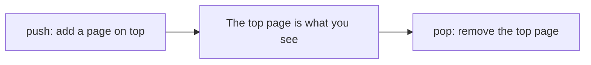

[Guide home](../README.md) · Back: [07 Lifecycle and Keys](07-lifecycle-and-keys.md) · Next: [09 State Management](09-state-management.md)

# Forms and Navigation

**Why this matters:** every app has screens and input. A login form is a popular live coding task.

**See it working:** `flutter run -d windows`, then open labs 4, 5 and 6.

---

# Part 1: Learn

## 1. TextField vs TextFormField

| Widget | Use it for |
|---|---|
| `TextField` | A plain text box, like a search box |
| `TextFormField` | A text box that's part of a `Form`, with a validator |

**Useful options:**

```dart
const TextField(
  keyboardType: TextInputType.emailAddress,  // which keyboard to show
  textInputAction: TextInputAction.next,     // the keyboard's action key
  obscureText: false,                        // true hides it, for passwords
  maxLength: 50,
  decoration: InputDecoration(
    labelText: 'Email',
    hintText: 'you@example.com',
    prefixIcon: Icon(Icons.email),
    border: OutlineInputBorder(),
  ),
)
```

**Getting the text.** There are two ways:

| Way | Good for |
|---|---|
| `TextEditingController`, then `.text` | Reading when needed, or changing the text from code |
| `onChanged: (text) {...}` | Reacting to each key press, like search |

## 2. Forms

A form has three pieces:

| Piece | Job |
|---|---|
| `GlobalKey<FormState>` | A remote control for the whole form |
| `TextFormField` + `validator` | One field and its rule |
| `TextEditingController` | Reads the text. **Must be disposed** |

**A validator** gets the current text, and returns **the error message**, or **`null` if it's fine**. That's the part people mix up.

```dart
String? validateEmail(String? value) {
  if (value == null || value.isEmpty) return 'Email is required';
  if (!value.contains('@')) return 'That is not an email';
  return null; // null means valid
}
```

**Checking the form:**

```dart
void _submit() {
  if (_formKey.currentState!.validate()) {  // runs every validator
    print('Welcome ${_emailController.text}');
  }
}
```

`validate()` runs all the validators, shows any errors under their fields, and returns `true` only if they all pass.

**Why the `!`?** `currentState` is null until the form is on screen. By the time someone presses a button, it's there, so this is a safe use of `!`.

**Why a `GlobalKey`?** You're outside the `Form`, but need to call a method on its state. A `GlobalKey` gives you that access.

The form's state also has `reset()` to clear it, and `save()` to run each field's `onSaved`.

## 3. Navigator: a stack of plates



`MaterialApp` creates a `Navigator`, which holds a **stack** of pages (called routes).

**Going to a page:**

```dart
Navigator.of(context).push(
  MaterialPageRoute(builder: (_) => const DetailsPage()),
);
```

**Going back:**

```dart
Navigator.of(context).pop();
```

`AppBar` adds a back arrow for you automatically.

**Other useful calls:**

| Call | What it does |
|---|---|
| `pushReplacement` | Swaps the current page. Use after login, so Back can't return to it |
| `pushAndRemoveUntil` | Clears the stack. Use after logout |
| `popUntil` | Goes back several pages |
| `canPop` | Is there anywhere to go back to? |

## 4. Passing data

**Forward: through the constructor.** A page is just a widget.

```dart
class TaskDetailsPage extends StatelessWidget {
  const TaskDetailsPage({super.key, required this.task});
  final Task task;
  // ...
}

Navigator.of(context).push(
  MaterialPageRoute(builder: (_) => TaskDetailsPage(task: task)),
);
```

**Back: through `pop`.** `push` returns a `Future`, which finishes when the page closes:

```dart
// First page
final answer = await Navigator.of(context).push<String>(
  MaterialPageRoute(builder: (_) => const PickerPage(title: 'Pick one')),
);
if (!mounted) return;
setState(() => _answer = answer ?? 'You pressed back');

// Second page
Navigator.of(context).pop('Mango');
```

`answer` is `null` if the user pressed back without choosing, so handle that.

**Why `mounted`?** There's an `await` here, so the screen might have gone by the time it finishes.

## 5. Dialogs and sheets

A dialog is also a route, so it works the same way, including returning a value:

```dart
final yes = await showDialog<bool>(
  context: context,
  builder: (dialogContext) => AlertDialog(
    title: const Text('Delete?'),
    actions: [
      TextButton(
        onPressed: () => Navigator.of(dialogContext).pop(true),
        child: const Text('Yes'),
      ),
    ],
  ),
);
```

`showModalBottomSheet` works in a similar way, sliding up from the bottom.

## 6. go_router: pages as addresses

Plain `Navigator` works well for simple apps. When you need **URLs and deep links**, use `go_router`. A **deep link** is a link that opens a specific screen, such as a product. The Flutter team recommends `go_router` for navigation.

**Setting it up:**

```dart
final GoRouter router = GoRouter(
  routes: [
    GoRoute(
      path: '/',
      builder: (context, state) => const HomePage(),
      routes: [
        GoRoute(
          path: 'product/:id',   // :id is a variable part
          builder: (context, state) => ProductPage(
            id: state.pathParameters['id']!,
            color: state.uri.queryParameters['color'],
          ),
        ),
      ],
    ),
  ],
);

MaterialApp.router(routerConfig: router)
```

**Going somewhere:**

| Call | What it does |
|---|---|
| `context.go('/x')` | **Replaces** the stack to match this address |
| `context.push('/x')` | **Adds** a page on top |
| `context.pop()` | Goes back |

For `/product/42?color=red`: `42` is the **path parameter**, and `color` is the **query parameter**.

**Protecting a screen behind login**, using `redirect`:

```dart
final protectedRouter = GoRouter(
  redirect: (context, state) {
    final goingToLogin = state.matchedLocation == '/login';
    if (!isLoggedIn && !goingToLogin) return '/login';
    return null; // null means carry on
  },
  routes: [ ... ],
);
```

## 7. Blocking the back button

```dart
PopScope(
  canPop: !hasUnsavedWork,
  onPopInvokedWithResult: (didPop, result) {
    if (!didPop) print('Ask the user to save first');
  },
  child: ...,
)
```

`PopScope` replaced the old `WillPopScope`.

## 8. Deep links

To open a screen from an outside link, you need two things: the router config above, plus native setup. That's **App Links** on Android, and **Universal Links** on iOS, which prove your app owns the website.

---

# Part 2: Code along: My Tasks, stage 3

**Goal:** a separate page for adding a task, with validation, and a details page. Keep working in `lib/my_app/main.dart`.

**Step 1: The validator.** Add this at the top level. It's a plain function, so it's easy to test.

```dart
String? validateTitle(String? value) {
  final title = value?.trim() ?? '';
  if (title.isEmpty) return 'Please enter a title';
  if (title.length < 3) return 'Use at least 3 characters';
  return null;
}
```

**Step 2: The add page.**

```dart
class AddTaskPage extends StatefulWidget {
  const AddTaskPage({super.key});

  @override
  State<AddTaskPage> createState() => _AddTaskPageState();
}

class _AddTaskPageState extends State<AddTaskPage> {
  final _formKey = GlobalKey<FormState>();
  final _titleController = TextEditingController();

  @override
  void dispose() {
    _titleController.dispose();
    super.dispose();
  }

  void _save() {
    if (_formKey.currentState!.validate()) {
      Navigator.of(context).pop(_titleController.text.trim());
    }
  }

  @override
  Widget build(BuildContext context) {
    return Scaffold(
      appBar: AppBar(title: const Text('Add task')),
      body: Padding(
        padding: const EdgeInsets.all(16),
        child: Form(
          key: _formKey,
          child: Column(
            spacing: 16,
            children: [
              TextFormField(
                controller: _titleController,
                decoration: const InputDecoration(labelText: 'Title'),
                validator: validateTitle,
              ),
              FilledButton(onPressed: _save, child: const Text('Save')),
            ],
          ),
        ),
      ),
    );
  }
}
```

`validator: validateTitle` passes the function itself, not a call to it. There are no brackets.

**Step 3: The details page.** Data comes in through the constructor.

```dart
class TaskDetailsPage extends StatelessWidget {
  const TaskDetailsPage({super.key, required this.task});

  final Task task;

  @override
  Widget build(BuildContext context) {
    return Scaffold(
      appBar: AppBar(title: const Text('Task details')),
      body: Center(
        child: Text('${task.title}: ${task.done ? 'finished' : 'not finished'}'),
      ),
    );
  }
}
```

**Step 4: Update `_TasksScreenState`.** Remove the `_titleController`, its `dispose`, and `_add`. Then add these:

```dart
  Future<void> _openAddPage() async {
    final title = await Navigator.of(context).push<String>(
      MaterialPageRoute(builder: (_) => const AddTaskPage()),
    );
    if (title == null || !mounted) return;
    setState(() {
      _tasks = [..._tasks, Task(id: _tasks.length + 1, title: title)];
    });
  }

  void _openDetails(Task task) {
    Navigator.of(context).push(
      MaterialPageRoute(builder: (_) => TaskDetailsPage(task: task)),
    );
  }
```

**Step 5: Update `build`.** There's no text box any more, so the body is just the list. Add a floating button:

```dart
  @override
  Widget build(BuildContext context) {
    final remaining = _tasks.where((task) => !task.done).length;
    return Scaffold(
      appBar: AppBar(title: Text('My Tasks ($remaining left)')),
      floatingActionButton: FloatingActionButton(
        onPressed: _openAddPage,
        tooltip: 'Add task',
        child: const Icon(Icons.add),
      ),
      body: ListView.builder(
        itemCount: _tasks.length,
        itemBuilder: (context, index) {
          final task = _tasks[index];
          return TaskTile(
            key: ValueKey(task.id),
            task: task,
            onToggle: () => _toggle(task.id),
            onOpen: () => _openDetails(task),
          );
        },
      ),
    );
  }
```

**Step 6: Update `TaskTile`.** It now has two actions, so `CheckboxListTile` isn't enough:

```dart
class TaskTile extends StatelessWidget {
  const TaskTile({
    super.key,
    required this.task,
    required this.onToggle,
    required this.onOpen,
  });

  final Task task;
  final VoidCallback onToggle;
  final VoidCallback onOpen;

  @override
  Widget build(BuildContext context) {
    return ListTile(
      leading: Checkbox(value: task.done, onChanged: (_) => onToggle()),
      title: Text(task.title),
      trailing: const Icon(Icons.chevron_right),
      onTap: onOpen,
    );
  }
}
```

Press `R`, and try it: press Save with an empty title, then with `ab`, then with a real one. Open a task as well.

**Stuck?** Compare with `lib/workbook_answers/tasks_app/stage08.dart`.

**Now change it yourself:**

- [ ] Add a "Delete" button on the details page. Return a value using `pop`, and act on it.
- [ ] Add a confirmation dialog before deleting.
- [ ] Add a second field for a description. You'll need to change `Task`, and return more than a String.

**Something to notice:** the details page receives a **copy** of the task. If you add a toggle there, the list won't know. That's the exact problem note 09 solves.

---

# Part 3: Workbook

**Open:** `lib/workbook/w08.dart`

**Check:** `flutter test workbook_test/w08_test.dart`

- [ ] 1 `validateEmail`
- [ ] 2 `validatePassword`
- [ ] 3 `LoginForm`: the whole form, from memory if you can
- [ ] 4 `ColorPage`: `pop` with a value
- [ ] 5 `ColorChooser`: `await push`, and `mounted`
- [ ] 6 `GreetingPage` and 7 `openGreeting`: passing data forward

---

# Part 4: Break it on purpose

- [ ] **Lab 4:** press Submit with an empty field, then with `nope`, then with `a@b.com`.
- [ ] **Lab 5:** open the page, and press the button. Do it again, and press back instead. You'll see a different result.
- [ ] **Lab 6:** open a product. Then in `labRouter`, change `/product/42?color=red` to another ID and color, and press `R`.
- [ ] In the validator, add a rule that the email must end in `.com`. Run the form test: `flutter test test/widget_test.dart`.
- [ ] In your `AddTaskPage`, remove `.trim()` from the validator. Then try a title of just spaces.

---

# Part 5: Test yourself

<details>
<summary>How do you pass data between screens?</summary>

Forward, I pass it through the next page's constructor. Backward, I call `Navigator.pop(value)`, and the caller `await`s the `push` to get it. For data many screens need, I use state management rather than passing it through each page.

</details>

<details>
<summary>What does a validator return?</summary>

The error message as a String, or `null` if the value is valid. `validate()` on the form runs them all, and returns true only if all return null.

</details>

<details>
<summary>Why do forms use a GlobalKey?</summary>

The key gives you access to `FormState` from outside the form. You can then call `validate()`, `save()` or `reset()` on all of its fields at once.

</details>

<details>
<summary><code>TextField</code> vs <code>TextFormField</code>?</summary>

`TextField` is a plain input. `TextFormField` wraps it for use inside a `Form`, adding a validator and connecting to `validate`, `save` and `reset`.

</details>

<details>
<summary><code>push</code> vs <code>pushReplacement</code>?</summary>

`push` adds a page on top, so Back returns to the previous one. `pushReplacement` swaps the current page, so Back can't return to it, which is what you want after login.

</details>

<details>
<summary>Navigator vs go_router?</summary>

`Navigator` is simple and built in, and it's fine for a stack of pages. `go_router` maps URLs to screens, so it handles deep links, web addresses, redirects like login checks, and nested navigation. The Flutter team recommends it for apps that need those.

</details>

<details>
<summary><code>context.go</code> vs <code>context.push</code>?</summary>

`go` changes the location, and rebuilds the stack to match that route. `push` adds a page on top of the current stack, so back returns to where you were.

</details>

<details>
<summary>What's a deep link?</summary>

A URL that opens a specific screen in the app, rather than the home page. It's handled with router config, plus some native setup: App Links on Android and Universal Links on iOS.

</details>

<details>
<summary>How do you protect a screen behind login in go_router?</summary>

Use the `redirect` callback. It runs on navigation, checks the login state, and returns `/login` if needed, or `null` to carry on.

</details>

<details>
<summary>Why does <code>Navigator.of(context)</code> sometimes fail?</summary>

The `context` has to be below a `Navigator` in the tree. If you use the context of the same widget that creates `MaterialApp`, there's no Navigator above it yet. The fix is to move the code into a child widget, or use a `Builder`.

</details>

# Done when

- [ ] You can write a validated login form from memory
- [ ] You can explain data going forward and back between screens
- [ ] You know when to choose go_router
- [ ] My Tasks has an add page and a details page, built by you
- [ ] At least 5 of 6 workbook tests pass

Next: [09 State Management](09-state-management.md)
