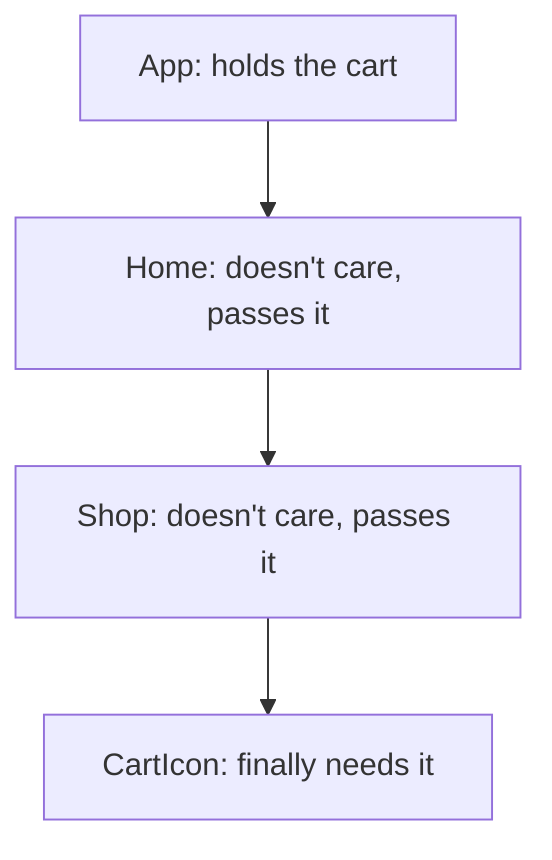
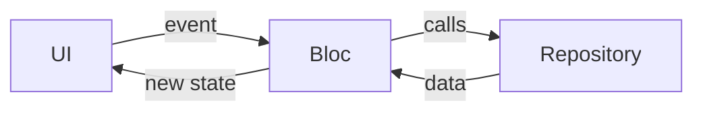

[Guide home](../README.md) · Back: [08 Forms and Navigation](08-forms-and-navigation.md) · Next: [10 Networking and Storage](10-networking-and-storage.md)

# State Management

**Why this matters:** you're almost guaranteed to get "Which state management do you use, and why?" A good answer compares options instead of naming a favourite.

**See it working:** `flutter run -d windows`, then open lab 7. It's **the same counter, written 7 ways**, in `lib/labs/state_labs.dart`.

---

# Part 1: Learn

## 1. What is state?

**State is any data that can change and affects what's on screen.** There are two kinds:

| Kind | Meaning | Examples | Use |
|---|---|---|---|
| **Ephemeral (local)** | Only one widget cares | Selected tab, animation, a text field | `setState` |
| **App state (shared)** | Many screens care | Logged-in user, cart, settings | A state management solution |

## 2. The problem we're solving

You saw it at the end of [08 Forms and Navigation](08-forms-and-navigation.md): the details page has a copy of the task, so a change there doesn't reach the list.

The cart icon on screen A and the checkout on screen C both need the same cart. You could keep it in a shared parent and pass it down, through every widget in between. That's called **prop drilling**, and it gets painful fast.



What we want instead: **keep the data in one place, outside the widgets, so that any widget can reach it, and gets told when it changes.** That's all state management is. The tools differ in how they do it.

## 3. setState

```dart
onAdd: () => setState(() => _count++),
```

It's built in. Use it for local state. You don't need anything bigger for a checkbox.

## 4. ValueNotifier: one value that shouts when it changes

A `ValueNotifier` holds one value, and tells its listeners when it changes. `ValueListenableBuilder` rebuilds **only its own part** of the screen, which makes it more efficient than `setState`.

```dart
class _NotifierCounterState extends State<NotifierCounter> {
  final _count = ValueNotifier<int>(0);

  @override
  void dispose() {
    _count.dispose();
    super.dispose();
  }

  @override
  Widget build(BuildContext context) {
    return ValueListenableBuilder<int>(
      valueListenable: _count,
      builder: (context, value, _) =>
          CounterView(count: value, onAdd: () => _count.value++),
    );
  }
}
```

There's no `setState`. Assigning to `.value` triggers the update.

## 5. ChangeNotifier: several values, and logic

`ChangeNotifier` is a built-in class with a list of listeners. You write a class that holds your data and logic, and call `notifyListeners()` when something changes. **This one is worth knowing well.**

```dart
class CounterModel extends ChangeNotifier {
  int _count = 0;              // private: nobody changes it directly
  int get count => _count;     // public: anyone can read it

  void add() {                 // the only way to change it
    _count++;
    notifyListeners();         // tell everyone
  }
}
```

If you forget `notifyListeners()`, the data changes, but the screen doesn't. And dispose it when you're done, as with any controller.

`ListenableBuilder` listens to one directly, with no packages:

```dart
ListenableBuilder(
  listenable: model,
  builder: (context, _) => Text('${model.count}'),
)
```

## 6. InheritedWidget: how Flutter passes data down

This is Flutter's own way to send data **down the tree**, without passing it through each widget. `Theme.of(context)` and `MediaQuery.of(context)` work like this. You rarely write one by hand, but interviewers ask how it works, because Provider is built on it.

```dart
class CountScope extends InheritedWidget {
  const CountScope({
    super.key,
    required this.count,
    required this.onAdd,
    required super.child,
  });
  final int count;
  final VoidCallback onAdd;

  // The ".of" pattern. It looks up the tree for the nearest CountScope.
  static CountScope of(BuildContext context) =>
      context.dependOnInheritedWidgetOfExactType<CountScope>()!;

  // Should the widgets that depend on this rebuild?
  @override
  bool updateShouldNotify(CountScope oldWidget) => oldWidget.count != count;
}
```

**How it works:**

1. `dependOnInheritedWidgetOfExactType` finds the nearest `CountScope` above this widget. It's a constant-time lookup, so it's fast at any depth.
2. It also **registers this widget** as a dependent.
3. When `CountScope` is rebuilt with a new value, and `updateShouldNotify` returns true, **only the registered dependents** rebuild.

That's also why `didChangeDependencies` exists, as you saw in [07 Lifecycle and Keys](07-lifecycle-and-keys.md).

## 7. Provider

**A friendlier wrapper around InheritedWidget.** You put a `ChangeNotifier` above the widgets that need it. It also disposes it for you.

**Add it to the tree:**

```dart
ChangeNotifierProvider(
  create: (_) => CounterModel(),
  child: const MyApp(),
)
```

**Read it, from any widget below:**

```dart
Consumer<CounterModel>(
  builder: (context, model, _) =>
      CounterView(count: model.count, onAdd: model.add),
)
```

**Or use the shorter context methods.** This is the part interviewers ask about:

| Read it with | Rebuilds on change? | Use it in |
|---|---|---|
| `context.watch<T>()` | Yes, on any change | `build` |
| `context.select<T, R>(...)` | Only if that part changes | `build`, for better performance |
| `context.read<T>()` | No | Callbacks like `onPressed` |

```dart
@override
Widget build(BuildContext context) {
  final count = context.select<CounterModel, int>((model) => model.count);
  return TextButton(
    onPressed: () => context.read<CounterModel>().add(),
    child: Text('$count'),
  );
}
```

**The downside:** providers are found by searching up the tree. If you forget one, you only find out **at runtime**, with a `ProviderNotFoundException`.

## 8. Riverpod

By Provider's author, and fixes its weak spots. Providers are declared **outside the widget tree**, so a missing one is caught earlier, and you don't need `BuildContext` to read them.

```dart
class RiverpodCounterNotifier extends Notifier<int> {
  @override
  int build() => 0;            // the starting state

  void add() => state++;       // setting `state` tells listeners
}

final riverpodCounter = NotifierProvider<RiverpodCounterNotifier, int>(
  RiverpodCounterNotifier.new,
);
```

The app needs a `ProviderScope` at the very top. A widget extends `ConsumerWidget` to get a `ref`:

```dart
class RiverpodReads extends ConsumerWidget {
  const RiverpodReads({super.key});

  @override
  Widget build(BuildContext context, WidgetRef ref) {
    final count = ref.watch(riverpodCounter);
    return TextButton(
      onPressed: () => ref.read(riverpodCounter.notifier).add(),
      child: Text('$count'),
    );
  }
}
```

| Call | Use it to | Where |
|---|---|---|
| `ref.watch(x)` | Read and rebuild on change | `build` |
| `ref.read(x)` | Read once | Callbacks |
| `ref.listen(x, ...)` | Run an action on change, like a snackbar | `build` |

Riverpod also has built-in handling of loading, data and error states for async work (`AsyncValue`), and can auto-dispose providers nobody's using.

## 9. Bloc and Cubit

The strictest option: **the UI sends something in, and state comes out.** It's popular in large teams, because everything follows the same pattern.

**Cubit is the simple one: call a method, emit a state.**

```dart
class CounterCubit extends Cubit<int> {
  CounterCubit() : super(0);          // the starting state
  void add() => emit(state + 1);      // emit sends out a new state
}
```

**Bloc adds events: send an event, get a state.** You can track exactly what happened, and when, and control how events get handled, such as debouncing a search.

```dart
sealed class CounterEvent {}
class AddPressed extends CounterEvent {}

class CounterBloc extends Bloc<CounterEvent, int> {
  CounterBloc() : super(0) {
    on<AddPressed>((event, emit) => emit(state + 1));
  }
}
```



**Using it in the UI:**

```dart
BlocProvider(
  create: (_) => CounterBloc(),
  child: BlocBuilder<CounterBloc, int>(
    builder: (context, count) => CounterView(
      count: count,
      onAdd: () => context.read<CounterBloc>().add(AddPressed()),
    ),
  ),
)
```

| Widget | Job |
|---|---|
| `BlocProvider` | Creates and provides the Bloc, and closes it |
| `BlocBuilder` | **Draws** the UI from state. May run many times |
| `BlocListener` | Does **one-time actions**: snackbar, navigate |
| `BlocConsumer` | Both together |
| `BlocSelector` | Rebuilds only when one part changes |

**Builder vs Listener is a common question.** You don't want a snackbar shown again each time the widget redraws:

```dart
BlocListener<CounterCubit, int>(
  listener: (context, count) {
    ScaffoldMessenger.of(context).showSnackBar(
      SnackBar(content: Text('Count is $count')),
    );
  },
  child: BlocBuilder<CounterCubit, int>(
    buildWhen: (previous, current) => current.isEven, // control rebuilds
    builder: (context, count) => Text('$count'),
  ),
)
```

> [!WARNING]
> **A common Bloc bug**
>
> Bloc ignores a new state that's equal to the current one. If you edit a list in place and emit that same list, the UI won't update. Always emit a **new** object. To compare by content, use `Equatable`.

**Testing:** a Bloc is easy to test, as you just send in events and check the states. The `bloc_test` package helps.

## 10. Other names you may hear

| Name | What it is |
|---|---|
| **GetX** | An all-in-one package. Popular, but often criticised for hiding too much |
| **MobX** | Observable values, with code generation |
| **Redux** | One global store, with actions and reducers |
| **get_it** | Not state management: a service locator for dependencies |

## 11. How to choose

| Option | Good for | Downside |
|---|---|---|
| `setState` | Local state | Doesn't share well |
| `ValueNotifier` | One simple value | Gets messy at scale |
| `InheritedWidget` | Understanding, and building your own tools | A lot of boilerplate |
| Provider | Small to medium apps, MVVM | Errors can appear at runtime, and it depends on `BuildContext` |
| Riverpod | Medium to large apps, async data | More concepts to learn |
| Bloc | Large teams, needing strict structure | More code to write |

## 12. Your interview answer

> "There's no single best option. I use `setState` for local state, like an animation. For shared state, I look at the app's size and the team. For a small or medium app, Provider with ChangeNotifier is simple, and it's what the Flutter team's own architecture guide uses as a base. On a larger team, I'd pick Bloc, for its strict structure and traceable events, or Riverpod, for compile-time safety and good async support. Whatever I choose, I keep logic out of widgets, so it's easy to test."

**Then add what you've actually used.** After today, you can honestly say: "I built a task app using Provider, and practised Riverpod and Bloc."

---

# Part 2: Code along: My Tasks, stage 4

**Goal:** fix the problem from note 08. Toggling a task on the details page should update the list as well.

Keep working in `lib/my_app/main.dart`.

**Step 1: Add the import** at the top:

```dart
import 'package:provider/provider.dart';
```

**Step 2: Create the store.** This moves the data and logic **out of the widget**. Notice there's no Flutter UI code in it.

```dart
class TaskStore extends ChangeNotifier {
  List<Task> _tasks = const [
    Task(id: 1, title: 'Learn widgets', done: true),
    Task(id: 2, title: 'Build a layout'),
    Task(id: 3, title: 'Pass the interview'),
  ];

  List<Task> get tasks => _tasks;
  int get remaining => _tasks.where((task) => !task.done).length;

  void toggle(int id) {
    _tasks = [
      for (final task in _tasks)
        if (task.id == id) task.copyWith(done: !task.done) else task,
    ];
    notifyListeners();
  }

  void add(String title) {
    _tasks = [..._tasks, Task(id: _tasks.length + 1, title: title)];
    notifyListeners();
  }
}
```

**Step 3: Provide it above everything.** Wrap `MaterialApp`, so that **every page** can reach it. This matters: pages you `push` sit under `MaterialApp`, not under each other.

```dart
class MyTasksApp extends StatelessWidget {
  const MyTasksApp({super.key});

  @override
  Widget build(BuildContext context) {
    return ChangeNotifierProvider(
      create: (_) => TaskStore(),
      child: MaterialApp(
        title: 'My Tasks',
        theme: ThemeData(colorSchemeSeed: Colors.indigo),
        home: const TasksScreen(),
      ),
    );
  }
}
```

**Step 4: Simplify `TasksScreen`.** It no longer holds state, so it goes back to a `StatelessWidget`. Replace both classes with this:

```dart
class TasksScreen extends StatelessWidget {
  const TasksScreen({super.key});

  Future<void> _openAddPage(BuildContext context) async {
    final store = context.read<TaskStore>();   // read before the await
    final title = await Navigator.of(context).push<String>(
      MaterialPageRoute(builder: (_) => const AddTaskPage()),
    );
    if (title != null) store.add(title);
  }

  @override
  Widget build(BuildContext context) {
    final tasks = context.watch<TaskStore>().tasks;  // rebuild when it changes
    return Scaffold(
      appBar: AppBar(title: const RemainingTitle()),
      floatingActionButton: FloatingActionButton(
        onPressed: () => _openAddPage(context),
        tooltip: 'Add task',
        child: const Icon(Icons.add),
      ),
      body: ListView.builder(
        itemCount: tasks.length,
        itemBuilder: (context, index) =>
            TaskTile(key: ValueKey(tasks[index].id), task: tasks[index]),
      ),
    );
  }
}
```

**Step 5: A title that rebuilds only when its number changes.** This uses `select`.

```dart
class RemainingTitle extends StatelessWidget {
  const RemainingTitle({super.key});

  @override
  Widget build(BuildContext context) {
    final remaining = context.select<TaskStore, int>((s) => s.remaining);
    return Text('My Tasks ($remaining left)');
  }
}
```

**Step 6: Update `TaskTile`.** It talks to the store itself now, so it doesn't need callbacks.

```dart
class TaskTile extends StatelessWidget {
  const TaskTile({super.key, required this.task});

  final Task task;

  @override
  Widget build(BuildContext context) {
    return ListTile(
      leading: Checkbox(
        value: task.done,
        onChanged: (_) => context.read<TaskStore>().toggle(task.id),
      ),
      title: Text(task.title),
      trailing: const Icon(Icons.chevron_right),
      onTap: () => Navigator.of(context).push(
        MaterialPageRoute(builder: (_) => TaskDetailsPage(taskId: task.id)),
      ),
    );
  }
}
```

**Why `read` in a callback?** A callback runs once, when tapped, so it doesn't need to listen.

**Step 7: The fix.** The details page now gets just an ID, and **looks the task up** in the store, so it's never out of date.

```dart
class TaskDetailsPage extends StatelessWidget {
  const TaskDetailsPage({super.key, required this.taskId});

  final int taskId;

  @override
  Widget build(BuildContext context) {
    final store = context.watch<TaskStore>();
    final task = store.tasks.firstWhere((task) => task.id == taskId);
    return Scaffold(
      appBar: AppBar(title: const Text('Task details')),
      body: Center(
        child: SwitchListTile(
          title: Text(task.title),
          value: task.done,
          onChanged: (_) => store.toggle(task.id),
        ),
      ),
    );
  }
}
```

Press `R`. Open a task, flip the switch, go back. **The list and title are updated.** That's shared state working. `AddTaskPage` doesn't change at all.

**Stuck?** Compare with `lib/workbook_answers/tasks_app/stage09.dart`.

**Now change it yourself:**

- [ ] Add a `delete` method to the store, and a button on the details page.
- [ ] Add a `print` to `RemainingTitle.build`. Add a task, then toggle two tasks in opposite directions, and notice when it doesn't rebuild.
- [ ] Remove `notifyListeners()` from `toggle`. See why it's needed. Put it back.
- [ ] Move `ChangeNotifierProvider` inside `MaterialApp`, around just `TasksScreen`. Then open a details page, and read the error. Why does it happen?

---

# Part 3: Workbook

Now practise the other tools, as you may be asked about them.

**Open:** `lib/workbook/w09.dart`

**Check:** `flutter test workbook_test/w09_test.dart`

- [ ] 1 `LikeButton`: `ValueNotifier`
- [ ] 2 `CartModel`: `ChangeNotifier`, with a new list on each change
- [ ] 3 `CartBadge`: `context.watch`
- [ ] 4 `AddToCartButton`: `context.read`
- [ ] 5 `ScoreNotifier`: Riverpod `Notifier`
- [ ] 6 `ScoreView`: Riverpod `ConsumerWidget`
- [ ] 7 `LightCubit`: Cubit
- [ ] 8 `LoginBloc`: Bloc with events. **This is the best preparation for a Bloc question**

---

# Part 4: Break it on purpose

Edit `lib/labs/state_labs.dart`, and press `R`:

- [ ] Remove `notifyListeners();` from `CounterModel.add`. The Provider counter stops updating on screen. Its value still goes up, but nobody is told.
- [ ] In `CounterCubit`, change `emit(state + 1)` to `emit(state)`. Nothing rebuilds, because the state is equal.
- [ ] In `RiverpodCounter`, replace `ProviderScope(child: Consumer(...))` with just the `Consumer(...)`. It fails with an error saying that no `ProviderScope` was found.
- [ ] In `ProviderCounter`, replace the `ChangeNotifierProvider(...)` with just its `p.Consumer<CounterModel>(...)`. It compiles, then fails on screen with a `ProviderNotFoundException`. That's the runtime error Riverpod is designed to avoid.

---

# Part 5: Test yourself

<details>
<summary>What's the difference between ephemeral and app state?</summary>

Ephemeral state is used by one widget, like a selected tab, so `setState` is fine. App state is shared across screens, like the logged-in user or a cart, so it needs a shared solution.

</details>

<details>
<summary>What problem does state management solve?</summary>

Sharing data between widgets without passing it through every level, and updating only the widgets that depend on it when it changes.

</details>

<details>
<summary>How does InheritedWidget work?</summary>

It sits high in the tree and holds data. A descendant calls `dependOnInheritedWidgetOfExactType`, which finds it in constant time and registers as a dependent. When it changes and `updateShouldNotify` returns true, only those dependents rebuild.

</details>

<details>
<summary>What's the role of ChangeNotifier?</summary>

It's a built-in class that holds a list of listeners. When you call `notifyListeners`, it tells them all. It's the base of Provider, and of ViewModels in the recommended architecture. Remember to dispose it.

</details>

<details>
<summary>ValueNotifier vs ChangeNotifier?</summary>

A `ValueNotifier` holds one value, and notifies automatically when you assign it. A `ChangeNotifier` is for a class with several values and methods, and you call `notifyListeners` yourself.

</details>

<details>
<summary>Provider: <code>watch</code> vs <code>read</code>?</summary>

`watch` listens, and rebuilds the widget on changes, so use it in `build`. `read` gets the value once with no listening, so use it in callbacks. Use `select` to rebuild only when one specific part changes.

</details>

<details>
<summary>Provider vs Riverpod?</summary>

Provider relies on the widget tree and `BuildContext`, so a missing provider only fails at runtime. Riverpod declares providers globally and doesn't need context to read them, so more mistakes are caught at compile time. It also has built-in handling of async states and auto-dispose.

</details>

<details>
<summary>Bloc vs Cubit?</summary>

Both produce a stream of states. A Cubit exposes methods, so it's simpler and has less code. A Bloc takes events, which adds code, but gives a clear record of what happened, and lets you control how events are handled, such as debouncing a search.

</details>

<details>
<summary>BlocBuilder vs BlocListener?</summary>

`BlocBuilder` draws UI and may rebuild many times. `BlocListener` runs a one-time action in response to a state, like showing a snackbar or navigating. Don't navigate inside a builder.

</details>

<details>
<summary>Why is state usually immutable?</summary>

Replacing state with a new object makes changes easy to detect, avoids bugs from something editing shared data unexpectedly, and makes the code easier to reason about and test.

</details>

<details>
<summary>When is <code>setState</code> enough?</summary>

When the data belongs to just that widget or a small subtree. Using a big framework for a checkbox is over-engineering.

</details>

<details>
<summary>What's wrong with a global variable for state?</summary>

Widgets aren't told when it changes, so the UI gets out of date. It also makes testing harder, because tests can affect each other.

</details>

# Done when

- [ ] You can give the interview answer in your own words
- [ ] You can write a Cubit and a ChangeNotifier from memory
- [ ] You can explain InheritedWidget
- [ ] My Tasks shares state across pages using Provider, built by you
- [ ] At least 6 of 8 workbook tests pass

Next: [10 Networking and Storage](10-networking-and-storage.md)
