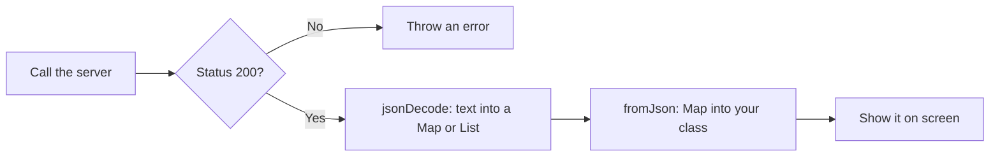
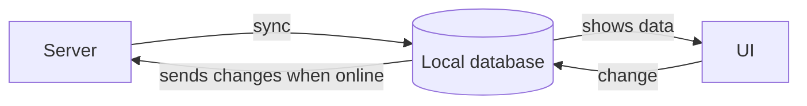

[Guide home](../README.md) · Back: [09 State Management](09-state-management.md) · Next: [11 App Architecture](11-app-architecture.md)

# Networking and Storage

**Why this matters:** almost every app fetches data and saves something. "Fetch a list from an API and show it" is the most common practical task.

**See it working:** `flutter run -d windows`, then open labs 8, 9 and 10.

---

# Part 1: Learn

## 1. How the web works, in brief

Your app sends a **request** to a server, and the server sends back a **response**.

| Part | Meaning | Example |
|---|---|---|
| **URL** | The address | `https://api.example.com/todos` |
| **Method** | What you want to do | `GET` read, `POST` create, `PUT` update, `DELETE` remove |
| **Headers** | Extra details | `Authorization: Bearer abc123` |
| **Body** | The data you send | `{"title": "Buy milk"}` |
| **Status code** | How it went | `200` OK, `201` created, `401` not logged in, `404` not found, `500` server error |

Status codes in the 200s mean success. The 400s mean your request was wrong. The 500s mean the server failed.

**JSON** is the usual format. It's text that looks like a Dart map:

```json
[
  {"id": 1, "title": "Learn widgets", "completed": true}
]
```

## 2. The whole flow



## 3. Calling an API

```dart
import 'dart:convert';
import 'package:http/http.dart' as http;

Future<List<Post>> fetchPosts(http.Client client) async {
  final response = await client.get(Uri.parse('https://example.test/posts'));
  if (response.statusCode != 200) {
    throw Exception('Server replied ${response.statusCode}');
  }
  return parsePosts(response.body);
}
```

- `as http` gives the package a short name, so you write `http.Client`.
- `Uri.parse` turns text into a proper address.
- `await` waits for the reply, without freezing the app.
- **Why pass in `http.Client`?** So that tests can use a pretend server. See [12 Testing](12-testing.md).

**Sending data, using POST:**

```dart
final response = await client.post(
  Uri.parse('https://example.test/posts'),
  headers: {'Content-Type': 'application/json'},
  body: jsonEncode({'title': 'Hello'}),
);
```

## 4. JSON into objects

`jsonDecode` turns text into Dart maps and lists. Those are `dynamic`, which you learned to be careful of in [02 Dart Basics](02-dart-basics.md). So **convert to your own class straight away**.

```dart
class Post {
  const Post({required this.id, required this.title, this.likes = 0});

  factory Post.fromJson(Map<String, dynamic> json) => Post(
    id: json['id'] as int,
    title: json['title'] as String,
    likes: json['likes'] as int? ?? 0,   // handles a missing field
  );

  final int id;
  final String title;
  final int likes;

  Map<String, dynamic> toJson() => {'id': id, 'title': title, 'likes': likes};
}
```

**Parsing a whole list:**

```dart
List<Post> parsePosts(String body) {
  final list = jsonDecode(body) as List<dynamic>;
  return list
      .map((item) => Post.fromJson(item as Map<String, dynamic>))
      .toList();
}
```

| Approach | Good for | Downside |
|---|---|---|
| Written by hand | Small models, no setup | Slow to write, and easy to make typos |
| `json_serializable` | Bigger apps | Needs a generate step (`build_runner`) |
| `freezed` | Immutable models with `copyWith` and equality | Needs a generate step too |

**Big JSON:** decoding a huge reply can freeze the UI. Do it in the background using `compute`. See [04 Dart Async](04-dart-async.md).

## 5. http vs dio

| Package | Good for |
|---|---|
| `http` | Simple calls. Official and small |
| `dio` | Interceptors (add auth tokens in one place, log requests), cancelling, upload progress |

An **interceptor** is code that runs on every request or reply. It's the usual place to attach a login token, and refresh it if it's expired.

## 6. Showing async data

### FutureBuilder

It draws differently as a `Future` progresses.

```dart
FutureBuilder<List<Post>>(
  future: posts,
  builder: (context, snapshot) {
    if (snapshot.connectionState != ConnectionState.done) {
      return const CircularProgressIndicator();
    }
    if (snapshot.hasError) return const Text('Something went wrong');
    final items = snapshot.data!;
    if (items.isEmpty) return const Text('No posts');
    return ListView.builder(
      itemCount: items.length,
      itemBuilder: (context, index) => Text(items[index].title),
    );
  },
)
```

`snapshot` is the current status: `connectionState`, `hasError`, `error`, `hasData` and `data`.

> [!WARNING]
> **Classic bug**
>
> Don't create the Future inside `build`:
> `FutureBuilder(future: fetchProfile(), ...)`
> Each rebuild starts a **new request**. Create it once, and keep it in a field or a ViewModel.

### StreamBuilder

The same idea for live data:

```dart
StreamBuilder<int>(
  stream: numbers,
  builder: (context, snapshot) =>
      Text(snapshot.hasData ? 'Now: ${snapshot.data}' : 'Waiting'),
)
```

For live connections such as chat, you'd use **WebSockets**, which keep a connection open both ways, and expose incoming messages as a Stream. The `web_socket_channel` package does this.

### Always handle four states

A good screen handles **loading, data, empty and error**. Mentioning this unprompted makes a good impression.

## 7. Handling problems

| Problem | What to do |
|---|---|
| **No internet** | Catch the error, and show a Retry button |
| **Slow server** | Add a timeout: `.timeout(const Duration(seconds: 10))` |
| **Failed temporarily** | Retry with increasing delays. It's challenge 7 in [17 Live Coding Practice](17-live-coding-practice.md) |
| **Expired login** | With `dio`, an interceptor can refresh the token and retry |

## 8. Saving data on the device

| Need | Use | Example |
|---|---|---|
| Small simple settings | `shared_preferences` | Dark mode on or off |
| **Secrets** | `flutter_secure_storage` | Login tokens |
| Structured data, queries | `sqflite`, `drift` | Offline orders |
| Files | `path_provider` + `dart:io` | Downloads |
| Cloud sync | Firebase Firestore | Shared data across devices |

```dart
final prefs = await SharedPreferences.getInstance();
await prefs.setString('name', 'Asha');
final name = prefs.getString('name') ?? 'Guest';
```

> [!CAUTION]
> **Never store tokens in shared_preferences**
>
> It's plain, unencrypted storage. Use `flutter_secure_storage`, which uses the Keychain on iOS and the Keystore on Android.

To save a list, convert it to JSON text first: `jsonEncode(tasks)`. That calls each object's `toJson`.

## 9. Working offline

**Offline-first** means the local database is the main source for the screen:



The user sees data immediately, and it still works with no signal. The hard part is deciding what happens when two devices change the same thing.

---

# Part 2: Code along: My Tasks, stage 5

**Goal:** load real tasks from a real server, handle errors, and keep a copy for offline use.

We'll use a free test API. Open this in your browser to see what comes back: `https://jsonplaceholder.typicode.com/todos?_limit=15`

Keep working in `lib/my_app/main.dart`.

**Step 1: Add these imports** at the top:

```dart
import 'dart:async';
import 'dart:convert';

import 'package:http/http.dart' as http;
import 'package:shared_preferences/shared_preferences.dart';
```

**Step 2: Teach `Task` about JSON.** Add these inside the class:

```dart
  factory Task.fromJson(Map<String, dynamic> json) => Task(
    id: json['id'] as int,
    title: json['title'] as String,
    done: json['completed'] as bool? ?? false,
  );

  Map<String, dynamic> toJson() => {
    'id': id,
    'title': title,
    'completed': done,
  };
```

**Step 3: Replace `TaskStore`.** It takes a client, and tracks loading and errors.

```dart
class TaskStore extends ChangeNotifier {
  TaskStore(this._client);

  static const _url = 'https://jsonplaceholder.typicode.com/todos?_limit=15';
  static const _cacheKey = 'tasks';

  final http.Client _client;
  List<Task> _tasks = const [];
  bool _isLoading = false;
  String? _error;

  List<Task> get tasks => _tasks;
  bool get isLoading => _isLoading;
  String? get error => _error;
  int get remaining => _tasks.where((task) => !task.done).length;

  Future<void> load() async {
    _isLoading = true;
    _error = null;
    notifyListeners();                 // show the spinner
    try {
      final response = await _client
          .get(Uri.parse(_url))
          .timeout(const Duration(seconds: 10));
      if (response.statusCode != 200) {
        throw Exception('Server replied ${response.statusCode}');
      }
      _tasks = _decode(response.body);
      await _saveCache();              // keep a copy for next time
    } catch (_) {
      final cached = await _readCache();
      if (cached.isEmpty) {
        _error = 'Could not load tasks. Check your internet.';
      } else {
        _tasks = cached;               // offline: use the saved copy
      }
    } finally {
      _isLoading = false;
      notifyListeners();               // hide the spinner, always
    }
  }

  void toggle(int id) {
    _tasks = [
      for (final task in _tasks)
        if (task.id == id) task.copyWith(done: !task.done) else task,
    ];
    notifyListeners();
    _saveCache();
  }

  void add(String title) {
    var nextId = 1;
    for (final task in _tasks) {
      if (task.id >= nextId) nextId = task.id + 1;
    }
    _tasks = [..._tasks, Task(id: nextId, title: title)];
    notifyListeners();
    _saveCache();
  }

  List<Task> _decode(String body) {
    final list = jsonDecode(body) as List<dynamic>;
    return list
        .map((item) => Task.fromJson(item as Map<String, dynamic>))
        .toList();
  }

  Future<void> _saveCache() async {
    final prefs = await SharedPreferences.getInstance();
    await prefs.setString(_cacheKey, jsonEncode(_tasks));
  }

  Future<List<Task>> _readCache() async {
    final prefs = await SharedPreferences.getInstance();
    final saved = prefs.getString(_cacheKey);
    return saved == null ? const [] : _decode(saved);
  }
}
```

Why `finally`? It runs whether the request worked or failed, so the spinner can never get stuck.

**Step 4: Start it from the app.** `..load()` is a cascade: it makes the store, starts loading, and gives you the store.

```dart
void main() => runApp(MyTasksApp(client: http.Client()));

class MyTasksApp extends StatelessWidget {
  const MyTasksApp({super.key, required this.client});

  final http.Client client;

  @override
  Widget build(BuildContext context) {
    return ChangeNotifierProvider(
      create: (_) => TaskStore(client)..load(),
      child: MaterialApp(
        title: 'My Tasks',
        theme: ThemeData(colorSchemeSeed: Colors.indigo),
        home: const TasksScreen(),
      ),
    );
  }
}
```

**Step 5: Handle all four states.** Replace `TasksScreen`:

```dart
class TasksScreen extends StatelessWidget {
  const TasksScreen({super.key});

  Future<void> _openAddPage(BuildContext context) async {
    final store = context.read<TaskStore>();
    final title = await Navigator.of(context).push<String>(
      MaterialPageRoute(builder: (_) => const AddTaskPage()),
    );
    if (title != null) store.add(title);
  }

  @override
  Widget build(BuildContext context) {
    final store = context.watch<TaskStore>();
    return Scaffold(
      appBar: AppBar(title: Text('My Tasks (${store.remaining} left)')),
      floatingActionButton: FloatingActionButton(
        onPressed: () => _openAddPage(context),
        tooltip: 'Add task',
        child: const Icon(Icons.add),
      ),
      body: _buildBody(store),
    );
  }

  Widget _buildBody(TaskStore store) {
    if (store.isLoading) {
      return const Center(child: CircularProgressIndicator());
    }
    final error = store.error;
    if (error != null) {
      return Center(
        child: Column(
          mainAxisSize: MainAxisSize.min,
          spacing: 12,
          children: [
            Text(error),
            FilledButton(onPressed: store.load, child: const Text('Retry')),
          ],
        ),
      );
    }
    if (store.tasks.isEmpty) {
      return const Center(child: Text('Nothing to do. Nice!'));
    }
    return ListView.builder(
      itemCount: store.tasks.length,
      itemBuilder: (context, index) {
        final task = store.tasks[index];
        return CheckboxListTile(
          key: ValueKey(task.id),
          title: Text(task.title),
          value: task.done,
          onChanged: (_) => store.toggle(task.id),
        );
      },
    );
  }
}
```

Delete `RemainingTitle`, `TaskTile`, `TaskDetailsPage` and `sampleTasks`, which aren't used now. Then **stop the app, and start it again**, since you added a plugin.

You should see a spinner, and then 15 tasks in Latin-looking text from the real server.

**Test each state:**

- [ ] Turn off your Wi-Fi, and restart the app. You see your saved tasks. **That's offline support.**
- [ ] Change the URL to something wrong, such as `/nope`. With the saved copy, you still see tasks. It's working as designed.
- [ ] To see the error screen, change `_cacheKey` to `'other'` as well, so that there's no saved copy. Press Retry. Then undo both.

**Stuck?** Compare with `lib/workbook_answers/tasks_app/stage10.dart`.

**Now change it yourself:**

- [ ] Add pull to refresh: wrap the list in `RefreshIndicator(onRefresh: store.load, child: ...)`.
- [ ] Bring back the details page, using the store.
- [ ] Add a 2 second delay in `load` to see the spinner properly.

---

# Part 3: Workbook

**Open:** `lib/workbook/w10.dart`

**Check:** `flutter test workbook_test/w10_test.dart`

- [ ] 1 `Post`: `fromJson`, `toJson`, a missing field
- [ ] 2 `parsePosts`: `jsonDecode` and `map`
- [ ] 3 `fetchPosts`: the status check, using an injected client
- [ ] 4 `PostsView`: `FutureBuilder`, all four states
- [ ] 5 `LiveCounter`: `StreamBuilder`
- [ ] 6 `saveName` and 7 `loadName`: `shared_preferences`

---

# Part 4: Break it on purpose

- [ ] **Lab 9:** flip "Break the server". See the error and retry button. Flip it back.
- [ ] **Lab 8:** in `AsyncLab`, replace `() => 'Asha loaded'` with `() => throw 'Server down'`, then press `R`.
- [ ] **Lab 10:** open it, press `R` to restart the app, and open it again. The count keeps going up, because it's saved on disk.
- [ ] In `Todo.fromJson` in `lib/architecture/todo_architecture.dart`, remove `?? false` and change `as bool?` to `as bool`. Run `flutter test`, and see the "missing completed field" test fail.
- [ ] **See the FutureBuilder bug:** in `lib/labs/app_labs.dart`, move the `Future.delayed(...)` from the `_profile` field directly into `future:` in `build`, and add a button that calls `setState`. Each press restarts the loading.

---

# Part 5: Test yourself

<details>
<summary>How do you call an API and show the result?</summary>

I keep the HTTP call in a repository. It checks the status code, decodes the JSON, and returns typed models. A ViewModel or Bloc calls it, and exposes loading, data and error states. The widget only draws those states.

</details>

<details>
<summary><code>jsonDecode</code> returns what?</summary>

A `Map<String, dynamic>` or `List<dynamic>`, which isn't type-safe. So I convert it into my own class right away, using `fromJson`.

</details>

<details>
<summary>GET vs POST? What do status codes mean?</summary>

GET reads data, and POST creates it. PUT updates, and DELETE removes. The 200s mean success, the 400s mean a bad request or not allowed, and the 500s mean the server failed.

</details>

<details>
<summary>Why's it a bug to create a Future inside <code>build</code>?</summary>

`build` can run many times. Each run creates a new Future, so `FutureBuilder` restarts, shows loading again, and makes repeated network calls. Create it once in `initState` or a field.

</details>

<details>
<summary><code>FutureBuilder</code> vs <code>StreamBuilder</code>?</summary>

Both draw from an async source, and rebuild as it changes. `FutureBuilder` is for a single result, and `StreamBuilder` is for many results over time.

</details>

<details>
<summary><code>http</code> vs <code>dio</code>?</summary>

`http` is small and simple. `dio` adds interceptors, cancelling, upload progress and easy global config. I'd choose `dio` when I need a central place for auth tokens and logging.

</details>

<details>
<summary>Where should you store a login token?</summary>

In `flutter_secure_storage`, which uses the platform's Keychain or Keystore. `shared_preferences` isn't encrypted, so it's not safe for secrets.

</details>

<details>
<summary>How would you make an app work offline?</summary>

Save data in a local database, and have the UI read from it, so it's the single source of truth. Sync with the server when online, queue local changes, and have a clear rule for conflicts.

</details>

<details>
<summary>How do you handle a slow or failed request?</summary>

Add a timeout, catch the errors, and show a clear message with a retry option. For temporary failures, retry a few times with increasing delays. Keep any old data on screen if you have it.

</details>

<details>
<summary><code>json_serializable</code> vs writing it by hand?</summary>

By hand needs no setup, and it's fine for small models. Code generation avoids typos and repetitive code in larger apps, with the cost of a build step. `freezed` also gives you immutability, `copyWith` and equality.

</details>

<details>
<summary>How would you handle live data, like chat?</summary>

A WebSocket keeps a two-way connection open, and its incoming messages arrive as a Stream. I'd read that in a repository, and handle reconnecting and saving history locally.

</details>

# Done when

- [ ] You can write a `fromJson` and a fetch method from memory
- [ ] You can explain the FutureBuilder bug
- [ ] You know where to store settings vs tokens
- [ ] My Tasks loads from a real server and works offline, built by you
- [ ] At least 5 of 6 workbook tests pass

Next: [11 App Architecture](11-app-architecture.md)
