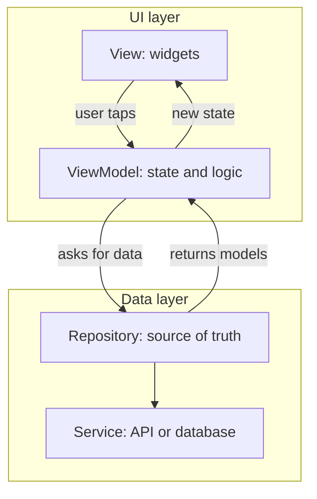

[Guide home](../README.md) · Back: [10 Networking and Storage](10-networking-and-storage.md) · Next: [12 Testing](12-testing.md)

# App Architecture

**Why this matters:** "How would you structure this app?" shows whether you can work on a real codebase, not just write screens.

**See it working:** open lab 9. Read `lib/architecture/todo_architecture.dart` from top to bottom. It's a complete mini app in one file.

---

# Part 1: Learn

## 1. The problem

Look at your `TaskStore` from note 10. It does **everything**: HTTP calls, JSON, saving to disk, screen state, and business rules. That causes problems:

- You can't test the logic without a real server.
- Changing from `http` to `dio` means touching your logic.
- Adding a local database means rewriting the class.
- A new developer has to read it all to change one thing.

The fix is to **split the code by job**.

## 2. The simple idea

A restaurant has separate jobs:

| Restaurant | App | Job |
|---|---|---|
| Waiter | **View** (widgets) | Shows things, and takes requests |
| Head waiter | **ViewModel** | Knows the state of the table, and decides what to do |
| Kitchen | **Repository** | Gets the food. Nobody else needs to know how |
| Suppliers | **Services/API** | Where the raw data comes from |

The waiter never cooks. **Widgets never hold business logic.**

## 3. The recommended layers

This is the structure from the official Flutter architecture guide:



| Layer | Knows about | Doesn't know about |
|---|---|---|
| View | The ViewModel | Where data comes from |
| ViewModel | The repository's interface | Widgets, HTTP |
| Repository | Services | The UI |

**Data flows down, and events flow up.** That's called **unidirectional data flow**. Because there's one path, it's easy to find out why something changed.

## 4. MVVM

This pattern is called **MVVM**: Model, View, ViewModel.

| Part | What it is | Rule |
|---|---|---|
| **Model** | Plain data classes | Immutable, no widgets |
| **View** | Widgets | Only draws state, and passes events up |
| **ViewModel** | A class holding screen state and logic | No widgets, and easy to test |

In Flutter, a ViewModel is usually a `ChangeNotifier`, a Cubit, or a Riverpod notifier. **Architecture and state management are separate choices.** You can do MVVM with any of them.

## 5. The repository pattern

A repository is **the only door to the data**. The rest of the app just asks it for things.

```dart
abstract class TaskRepository {
  Future<List<Task>> fetchTasks();
  Future<void> saveTasks(List<Task> tasks);
}
```

It's an **abstract class**, so it's a promise, with no code. The real version implements it:

```dart
class ApiTaskRepository implements TaskRepository { /* real HTTP and cache */ }
```

The rest of the app only knows about `TaskRepository`. You could swap the API for a database, or a fake for tests, and **nothing else changes**.

**Repository vs Service:** a service wraps one source, such as one API. A repository combines sources, and decides things like "use the cache if the network fails". Small apps often skip the separate service.

## 6. Dependency injection

**Dependency injection (DI) means giving an object what it needs, rather than letting it create those things itself.** It's like a chef being handed ingredients, instead of having to grow them.

```dart
// Hard to test: it's stuck with the real server
class BadViewModel {
  final repository = ApiTaskRepository(http.Client());
}

// Easy to test: pass in whichever version you need
class TasksViewModel extends ChangeNotifier {
  TasksViewModel(this._repository);
  final TaskRepository _repository;
}
```

Notice the type is the **abstract** `TaskRepository`.

| How to inject | Note |
|---|---|
| Constructor parameters | The simplest. You'll use this now |
| `provider` | Puts it in the widget tree |
| `riverpod` | Providers can depend on each other |
| `get_it` | A global service locator |

## 7. Modelling state with a sealed class

In note 10, you used separate `isLoading` and `error` fields. Nothing stops them from contradicting each other: loading **and** an error **and** data, all at once.

A sealed class makes bad combinations **impossible**:

```dart
sealed class TasksState {
  const TasksState();
}

class TasksLoading extends TasksState {
  const TasksLoading();
}

class TasksLoaded extends TasksState {
  const TasksLoaded(this.tasks);
  final List<Task> tasks;
}

class TasksFailed extends TasksState {
  const TasksFailed(this.message);
  final String message;
}
```

The state is exactly one of these. And a `switch` won't compile if you forget a case.

## 8. Domain layer, and clean architecture

**Domain layer:** an optional middle layer of **use cases**, such as `PlaceOrder`, between ViewModels and repositories. It's for logic that's complex or shared by several ViewModels. For simple apps, it's unnecessary extra code.

**Clean architecture:** a stricter form with presentation, domain and data layers, where dependencies point inward, so the domain knows nothing about Flutter or APIs. It's powerful for large apps, but too much for small ones.

## 9. Folder structure

Organise by **feature**, not by file type, so related code stays together:

```text
lib/
  ui/
    tasks/
      tasks_screen.dart
      tasks_view_model.dart
    core/            shared widgets and theme
  data/
    repositories/
      task_repository.dart
    services/
  domain/
    models/
      task.dart
```

## 10. What the Flutter team recommends

| Priority | Recommendation |
|---|---|
| **Strongly recommended** | Separate UI and data layers |
| | Repository pattern |
| | MVVM: Views and ViewModels |
| | No logic in widgets |
| | One-way data flow |
| | Immutable data models |
| | Dependency injection |
| | Abstract repository classes |
| | Test each part separately, and together, using fakes |
| **Recommended** | Commands for handling user events |
| | `freezed` or `built_value` for models |
| | `go_router` for navigation |
| | Consistent naming |
| **Only if needed** | A domain layer, for logic shared across ViewModels |
| | Separate API and domain models |

A **Command** is a small object that wraps an action, along with its running, success and error state. It saves you tracking those by hand for each button.

## 11. Design principles, in plain language

| Principle | Simple meaning | In My Tasks |
|---|---|---|
| **S**ingle responsibility | Each class has one job | The repository only handles data |
| **O**pen/closed | Add features without rewriting working code | Add a new repository without touching the ViewModel |
| **L**iskov substitution | A subclass must work wherever its parent is expected | A fake repository works just like the real one |
| **I**nterface segregation | Prefer small interfaces over one giant one | `TaskRepository` only has what tasks need |
| **D**ependency inversion | Depend on abstractions | The ViewModel depends on `TaskRepository`, not the API |

Common patterns you might be asked to name: **Repository**, **Observer** (`ChangeNotifier`, Streams), **Singleton**, **Factory** (`fromJson`), **Builder** (`ListView.builder`).

---

# Part 2: Code along: My Tasks, stage 6

**Goal:** split `TaskStore` into layers. The app will look **exactly the same**. That's the point of a refactor.

Keep working in `lib/my_app/main.dart`. In a real app these would be separate files, but one file makes it easier to learn.

**Step 1: Move JSON decoding out.** Add this at the top level:

```dart
List<Task> decodeTasks(String body) {
  final list = jsonDecode(body) as List<dynamic>;
  return list
      .map((item) => Task.fromJson(item as Map<String, dynamic>))
      .toList();
}
```

**Step 2: The repository.** This holds everything about **where data comes from**.

```dart
abstract class TaskRepository {
  Future<List<Task>> fetchTasks();
  Future<void> saveTasks(List<Task> tasks);
}

class ApiTaskRepository implements TaskRepository {
  ApiTaskRepository(this._client);

  static const _url = 'https://jsonplaceholder.typicode.com/todos?_limit=15';
  static const _cacheKey = 'tasks';

  final http.Client _client;

  @override
  Future<List<Task>> fetchTasks() async {
    try {
      final response = await _client
          .get(Uri.parse(_url))
          .timeout(const Duration(seconds: 10));
      if (response.statusCode != 200) {
        throw Exception('Server replied ${response.statusCode}');
      }
      final tasks = decodeTasks(response.body);
      await saveTasks(tasks);
      return tasks;
    } catch (_) {
      final prefs = await SharedPreferences.getInstance();
      final saved = prefs.getString(_cacheKey);
      if (saved == null) rethrow;
      return decodeTasks(saved);
    }
  }

  @override
  Future<void> saveTasks(List<Task> tasks) async {
    final prefs = await SharedPreferences.getInstance();
    await prefs.setString(_cacheKey, jsonEncode(tasks));
  }
}
```

`rethrow` passes on the same error, as we've no copy to fall back on.

**Step 3: The state.** Add the three classes and the sealed parent from section 7 above.

**Step 4: The ViewModel.** Replace `TaskStore` with this. Look at what's gone: **no HTTP, no JSON, no disk, no widgets.**

```dart
class TasksViewModel extends ChangeNotifier {
  TasksViewModel(this._repository);

  final TaskRepository _repository;
  TasksState _state = const TasksLoading();

  TasksState get state => _state;

  int get remaining => switch (_state) {
    TasksLoaded(:final tasks) => tasks.where((task) => !task.done).length,
    _ => 0,
  };

  Future<void> load() async {
    _state = const TasksLoading();
    notifyListeners();
    try {
      _state = TasksLoaded(await _repository.fetchTasks());
    } catch (_) {
      _state = const TasksFailed('Could not load tasks. Check your internet.');
    }
    notifyListeners();
  }

  void toggle(int id) {
    final current = _state;
    if (current is! TasksLoaded) return;
    _update([
      for (final task in current.tasks)
        if (task.id == id) task.copyWith(done: !task.done) else task,
    ]);
  }

  void add(String title) {
    final current = _state;
    if (current is! TasksLoaded) return;
    var nextId = 1;
    for (final task in current.tasks) {
      if (task.id >= nextId) nextId = task.id + 1;
    }
    _update([...current.tasks, Task(id: nextId, title: title)]);
  }

  void _update(List<Task> tasks) {
    _state = TasksLoaded(tasks);
    notifyListeners();
    _repository.saveTasks(tasks);
  }
}
```

`final current = _state;` is needed because Dart can't promote a field, since it could change. A local variable can be promoted, after the `is!` check.

**Step 5: The wiring.** This is where the real pieces get connected.

```dart
void main() {
  final repository = ApiTaskRepository(http.Client());
  runApp(MyTasksApp(viewModel: TasksViewModel(repository)..load()));
}

class MyTasksApp extends StatelessWidget {
  const MyTasksApp({super.key, required this.viewModel});

  final TasksViewModel viewModel;

  @override
  Widget build(BuildContext context) {
    return MaterialApp(
      title: 'My Tasks',
      theme: ThemeData(colorSchemeSeed: Colors.indigo),
      home: TasksScreen(viewModel: viewModel),
    );
  }
}
```

**Step 6: The View.** It only draws state, and passes taps up. Replace `TasksScreen`:

```dart
class TasksScreen extends StatelessWidget {
  const TasksScreen({super.key, required this.viewModel});

  final TasksViewModel viewModel;

  Future<void> _openAddPage(BuildContext context) async {
    final title = await Navigator.of(context).push<String>(
      MaterialPageRoute(builder: (_) => const AddTaskPage()),
    );
    if (title != null) viewModel.add(title);
  }

  @override
  Widget build(BuildContext context) {
    return Scaffold(
      appBar: AppBar(
        title: ListenableBuilder(
          listenable: viewModel,
          builder: (context, _) =>
              Text('My Tasks (${viewModel.remaining} left)'),
        ),
      ),
      floatingActionButton: FloatingActionButton(
        onPressed: () => _openAddPage(context),
        tooltip: 'Add task',
        child: const Icon(Icons.add),
      ),
      body: ListenableBuilder(
        listenable: viewModel,
        builder: (context, _) => switch (viewModel.state) {
          TasksLoading() => const Center(child: CircularProgressIndicator()),
          TasksFailed(:final message) => Center(
            child: Column(
              mainAxisSize: MainAxisSize.min,
              spacing: 12,
              children: [
                Text(message),
                FilledButton(
                  onPressed: viewModel.load,
                  child: const Text('Retry'),
                ),
              ],
            ),
          ),
          TasksLoaded(:final tasks) when tasks.isEmpty => const Center(
            child: Text('Nothing to do. Nice!'),
          ),
          TasksLoaded(:final tasks) => ListView.builder(
            itemCount: tasks.length,
            itemBuilder: (context, index) => CheckboxListTile(
              key: ValueKey(tasks[index].id),
              title: Text(tasks[index].title),
              value: tasks[index].done,
              onChanged: (_) => viewModel.toggle(tasks[index].id),
            ),
          ),
        },
      ),
    );
  }
}
```

`when tasks.isEmpty` adds an extra condition to a case. Remove the `provider` import, since you don't use it now. Press `R`. **The app looks the same, but it's now properly structured.**

**Stuck?** Compare with `lib/workbook_answers/tasks_app/stage11.dart`. That file also has the changes from notes 13 and 14.

**Step 7: Prove it was worth it.** Add a fake repository, and swap it in `main`:

```dart
class FakeTaskRepository implements TaskRepository {
  @override
  Future<List<Task>> fetchTasks() async => const [
    Task(id: 1, title: 'From the fake'),
  ];

  @override
  Future<void> saveTasks(List<Task> tasks) async {}
}
```

```dart
final repository = FakeTaskRepository();
```

Press `R`. The screen works, with **no other changes**. **This is the whole point of the pattern.** Change it back afterward.

**Now change it yourself:**

- [ ] Add a `TasksEmpty` state to the sealed class. Follow the compile errors to fix everything.
- [ ] Add `delete` to the ViewModel, with a button in the View. Keep the logic in the ViewModel.

---

# Part 3: Workbook

Build a new feature, from the bottom up, by yourself.

**Open:** `lib/workbook/w11.dart`

**Check:** `flutter test workbook_test/w11_test.dart`

- [ ] 1 `InMemoryNotesRepository`: implement the abstract class
- [ ] 2 `NotesViewModel`: injected repository, states, errors. **The test passes in a failing repository, so your class has to handle it**
- [ ] 3 `NotesView`: draw the state, using `ListenableBuilder`

---

# Part 4: Test yourself

<details>
<summary>How would you structure a new Flutter app?</summary>

I'd separate UI and data layers, following the official guide. Each screen gets a View and a ViewModel. The data layer has repositories as the source of truth, which use services for APIs and databases. Data flows one way, models are immutable, and dependencies are injected, so everything's testable. I'd organise folders by feature.

</details>

<details>
<summary>What's the repository pattern, and why use it?</summary>

A repository is one class that hides where data comes from. The rest of the app just asks it for data. That means I can change the API, add caching, or use a fake in tests, without touching the UI.

</details>

<details>
<summary>Explain MVVM.</summary>

Model is the data. View is the widgets, which only draw state and send events up. ViewModel holds the screen's state and logic, gets data from repositories, and notifies the View of changes. Since the ViewModel has no widgets, it's easy to test.

</details>

<details>
<summary>What is dependency injection, and why does it matter?</summary>

Giving a class its dependencies from outside, rather than having it create them. It makes code flexible and testable, because you can pass a fake repository in a test.

</details>

<details>
<summary>What's unidirectional data flow?</summary>

State flows down from the data layer to the UI, and user events flow up. There's one clear path, so it's easier to find out why something changed.

</details>

<details>
<summary>Why use a sealed class for state, rather than separate fields?</summary>

With separate `isLoading` and `error` fields, impossible combinations can happen. With a sealed class, the state is exactly one case, and the compiler forces the UI to handle them all.

</details>

<details>
<summary>What's the difference between architecture and state management?</summary>

Architecture is how the code is divided into layers, and who may talk to whom. State management is how the UI learns about changes. MVVM can use `ChangeNotifier`, Cubit or Riverpod.

</details>

<details>
<summary>When do you need a domain layer?</summary>

When logic is complex or several ViewModels need the same logic, or when a ViewModel has grown too large. For simple apps, it's unnecessary extra code.

</details>

<details>
<summary>What's clean architecture?</summary>

Separating code into layers, with dependencies pointing inward toward the business logic: presentation, domain and data. The domain doesn't depend on Flutter or an API. It's powerful for large apps, but too much for small ones.

</details>

<details>
<summary>Why no logic in widgets?</summary>

Widget logic is harder to test, because you need the UI. It's also harder to reuse, and it clutters `build`. Moving it to a ViewModel means simple unit tests can cover it.

</details>

<details>
<summary>What are the SOLID principles?</summary>

Single responsibility: each class has one job. Open/closed: extend without rewriting. Liskov: a subclass works wherever its parent does. Interface segregation: small interfaces. Dependency inversion: depend on abstractions. Then give an example, like the ViewModel depending on an abstract repository.

</details>

# Done when

- [ ] You can draw the layers from memory
- [ ] You refactored My Tasks, and swapped in a fake repository with no other changes
- [ ] You can explain DI in one sentence
- [ ] The notes feature passes its workbook tests

Next: [12 Testing](12-testing.md)
