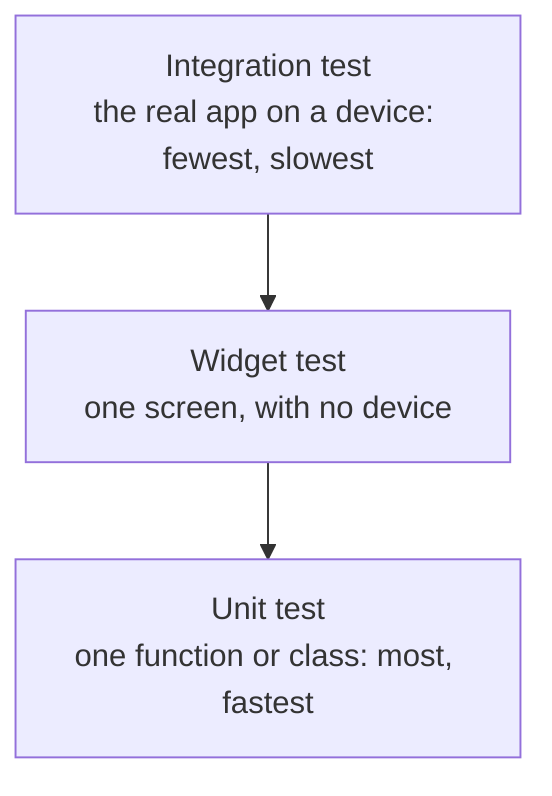

[Guide home](../README.md) · Back: [11 App Architecture](11-app-architecture.md) · Next: [13 Performance and Debugging](13-performance-and-debugging.md)

# Testing

**Why this matters:** many candidates have little to say here. A clear answer helps you stand out. You've already been reading tests in the workbooks, and now you'll write them.

**See it working:**

```powershell
flutter test
flutter test test/architecture_test.dart
flutter test integration_test -d windows
```

---

# Part 1: Learn

## 1. Why test?

A test is code that checks your code. It catches bugs before users do, and it lets you change code without fear. Here's a real example: while building My Tasks for these notes, a widget test caught a bug that looked fine on screen. You'll see it in [14 Animation Theme and Accessibility](14-animation-theme-and-accessibility.md).

## 2. The three kinds of test



| Type | Tests | Speed | Confidence | Needs a device? |
|---|---|---|---|---|
| **Unit** | One function or class | Very fast | Lower | No |
| **Widget** | One widget or screen | Fast | Medium | No |
| **Integration** | The whole app | Slow | Highest | Yes |

Write lots of unit tests, a good number of widget tests, and a few integration tests for key journeys such as login or checkout.

## 3. Unit tests

Test files live in `test/`, and their names end in `_test.dart`.

```dart
import 'package:flutter_test/flutter_test.dart';

void main() {
  test('copyWith does not change the original', () {
    const original = Todo(id: 1, title: 'A');  // Arrange: set things up

    final changed = original.copyWith(done: true);  // Act: do the thing

    expect(original.done, isFalse);  // Assert: check the result
    expect(changed.done, isTrue);
  });
}
```

**Arrange, act, assert** is the shape of nearly every test.

**`expect(actual, matcher)`** does the checking. Common matchers:

| Matcher | Checks |
|---|---|
| `expect(x, 5)` | Equals |
| `isTrue`, `isFalse`, `isNull`, `isNotNull` | The obvious |
| `isA<TasksLoaded>()` | The type |
| `contains('a')` | Inside a list or string |
| `throwsException`, `throwsStateError` | It throws |

**Group related tests:**

```dart
group('Model', () {
  test('fromJson reads the fields', () { /* ... */ });
  test('a missing field means not done', () { /* ... */ });
});
```

**Setup and cleanup:** `setUp` runs before each test, and `tearDown` after.

**Async tests** just use `async` and `await`:

```dart
test('load goes from loading to loaded', () async {
  final viewModel = TasksViewModel(FakeTaskRepository());
  expect(viewModel.state, isA<TasksLoading>());
  await viewModel.load();
  expect(viewModel.state, isA<TasksLoaded>());
});
```

**Testing that something throws:**

```dart
// For a normal function, wrap it in a function
expect(() => account.withdraw(999), throwsStateError);

// For a Future, await it
await expectLater(fetchPosts(badClient), throwsException);
```

## 4. Fakes and mocks

Tests shouldn't call a real server. They'd be slow and unreliable. So you swap in a stand-in. This only works because of dependency injection from [11 App Architecture](11-app-architecture.md). **Good architecture makes testing easy.**

| | **Fake** | **Mock** |
|---|---|---|
| What it is | A small working version | A recording of expected calls |
| You check | The **result** | **How it was called** |
| Official guidance | Recommended | Use if you need to check calls |

**A fake** is just a class you write:

```dart
class FakeTaskRepository implements TaskRepository {
  FakeTaskRepository({this.shouldFail = false});

  final bool shouldFail;
  List<Task>? saved;

  @override
  Future<List<Task>> fetchTasks() async {
    if (shouldFail) throw Exception('No internet');
    return const [
      Task(id: 1, title: 'First'),
      Task(id: 2, title: 'Second', done: true),
    ];
  }

  @override
  Future<void> saveTasks(List<Task> tasks) async => saved = tasks;
}
```

**A mock**, using the `mocktail` package, can be told what to answer, and asked what happened:

```dart
class MockPriceApi extends Mock implements PriceApi {}

test('total asks the API once for each item', () async {
  final api = MockPriceApi();
  when(() => api.priceOf('Tea')).thenAnswer((_) async => 5);  // set the answer

  expect(await Checkout(api).total(['Tea']), 5);

  verify(() => api.priceOf('Tea')).called(1);                 // check the call
});
```

**A fake HTTP server:** the `http` package includes `MockClient`, so you can test the repository itself:

```dart
final client = MockClient(
  (request) async => http.Response('[{"id":1,"title":"A"}]', 200),
);
```

## 5. Widget tests

Flutter builds your widget in a test environment, with no screen. You find things, tap them, then check.

```dart
testWidgets('the form shows errors', (tester) async {
  await tester.pumpWidget(
    const MaterialApp(home: Scaffold(body: FormLab())),
  );

  await tester.tap(find.text('Submit'));
  await tester.pump();

  expect(find.text('Email is required'), findsOneWidget);
});
```

**Most widgets need `MaterialApp` and `Scaffold` around them**, for theme and text direction. That's why you see that wrapper everywhere.

| Tool | What it does |
|---|---|
| `pumpWidget(w)` | Builds the widget |
| `pump()` | Draws one frame. **Nothing updates until you pump** |
| `pump(duration)` | Moves time forward. Great for debounce and timers |
| `pumpAndSettle()` | Keeps pumping until animations finish |
| `tap(finder)` | Taps it |
| `enterText(finder, 'hi')` | Types in a field |
| `drag(finder, offset)` | Drags, as in scrolling |

| Finders | Matchers |
|---|---|
| `find.text('Save')` | `findsOneWidget` |
| `find.byType(ListTile)` | `findsNothing` |
| `find.byKey(const Key('email'))` | `findsWidgets` |
| `find.byIcon(Icons.add)` | `findsNWidgets(3)` |

> [!WARNING]
> **A trap**
>
> `pumpAndSettle` never finishes if an animation runs forever, like a spinner. The test times out. Use `pump(duration)` there instead.

**Testing time without really waiting.** Test time is fake, so this runs instantly:

```dart
await tester.enterText(find.byKey(const Key('search')), 'Item 19');
await tester.pump(const Duration(milliseconds: 200));
expect(find.text('Showing 20 of 200'), findsOneWidget); // too early
await tester.pump(const Duration(milliseconds: 300));
expect(find.text('Showing 11 of 11'), findsOneWidget);
```

## 6. Integration tests

These run the real app on a real device or desktop. They live in `integration_test/`.

```dart
void main() {
  IntegrationTestWidgetsFlutterBinding.ensureInitialized();

  testWidgets('open the form lab and submit a real email', (tester) async {
    await tester.pumpWidget(const LabApp());
    await tester.tap(find.text('Forms'));
    await tester.pumpAndSettle();
    await tester.enterText(find.byType(TextFormField), 'asha@example.com');
    await tester.tap(find.text('Submit'));
    await tester.pumpAndSettle();
    expect(find.text('Welcome asha@example.com'), findsOneWidget);
  });
}
```

## 7. Golden tests

A golden test compares a widget's rendered image with a saved one, to catch visual changes:

```dart
await expectLater(find.byType(MyCard), matchesGoldenFile('my_card.png'));
```

Create or update the saved image using `flutter test --update-goldens`. Rendering can differ across operating systems, so generate them in the same environment you test on.

## 8. Coverage

```powershell
flutter test --coverage
```

This writes `coverage/lcov.info`. Coverage shows what code ran, not whether the tests check the right things. So 100% coverage doesn't mean no bugs.

**TDD** (test-driven development) means writing a failing test first, then the code to make it pass. It's what you've been doing in the workbooks.

---

# Part 2: Code along: test My Tasks

**Goal:** real tests for the app you built. Create a new file, `test/my_tasks_test.dart`.

**Step 1: The imports, and a fake.**

```dart
import 'package:flutter/material.dart';
import 'package:flutter_interview_lab/my_app/main.dart';
import 'package:flutter_test/flutter_test.dart';

class TestRepository implements TaskRepository {
  TestRepository({this.shouldFail = false});

  final bool shouldFail;
  List<Task>? saved;

  @override
  Future<List<Task>> fetchTasks() async {
    if (shouldFail) throw Exception('No internet');
    return const [
      Task(id: 1, title: 'First'),
      Task(id: 2, title: 'Second', done: true),
    ];
  }

  @override
  Future<void> saveTasks(List<Task> tasks) async => saved = tasks;
}
```

Your `FakeTaskRepository` from note 11 is in `main.dart`, so this uses a different name.

**Step 2: Unit tests.** These test the model and validator.

```dart
void main() {
  group('Model', () {
    test('fromJson reads the fields', () {
      final task = Task.fromJson({'id': 1, 'title': 'A', 'completed': true});
      expect(task.title, 'A');
      expect(task.done, isTrue);
    });

    test('copyWith does not change the original', () {
      const original = Task(id: 1, title: 'A');
      expect(original.copyWith(done: true).done, isTrue);
      expect(original.done, isFalse);
    });
  });

  test('validateTitle', () {
    expect(validateTitle(''), 'Please enter a title');
    expect(validateTitle('ab'), 'Use at least 3 characters');
    expect(validateTitle('abc'), isNull);
  });
}
```

Run it using `flutter test test/my_tasks_test.dart`.

**Step 3: ViewModel tests.** Add this inside `main`. It needs no widgets and no server, which is why you split the layers.

```dart
  group('ViewModel', () {
    test('load goes from loading to loaded', () async {
      final viewModel = TasksViewModel(TestRepository());
      expect(viewModel.state, isA<TasksLoading>());
      await viewModel.load();
      expect(viewModel.state, isA<TasksLoaded>());
      expect(viewModel.remaining, 1);
    });

    test('load shows failure when the repository fails', () async {
      final viewModel = TasksViewModel(TestRepository(shouldFail: true));
      await viewModel.load();
      expect(viewModel.state, isA<TasksFailed>());
    });

    test('toggle changes the task, notifies and saves', () async {
      final repository = TestRepository();
      final viewModel = TasksViewModel(repository);
      await viewModel.load();
      var notified = 0;
      viewModel.addListener(() => notified++);

      viewModel.toggle(1);

      expect(viewModel.remaining, 0);
      expect(notified, 1);
      expect(repository.saved?.first.done, isTrue);
    });
  });
```

**Step 4: Widget tests.** Add a helper, and tests for what the user sees:

```dart
  group('Screen', () {
    Future<void> pumpApp(WidgetTester tester, TaskRepository repository) async {
      final viewModel = TasksViewModel(repository);
      await tester.pumpWidget(MyTasksApp(viewModel: viewModel));
      await viewModel.load();
      await tester.pump();
    }

    testWidgets('shows tasks, and tapping one updates the title', (
      tester,
    ) async {
      await pumpApp(tester, TestRepository());
      expect(find.text('First'), findsOneWidget);
      expect(find.text('My Tasks (1 left)'), findsOneWidget);
      await tester.tap(find.text('First'));
      await tester.pumpAndSettle();
      expect(find.text('My Tasks (0 left)'), findsOneWidget);
    });

    testWidgets('shows the error and a Retry button', (tester) async {
      await pumpApp(tester, TestRepository(shouldFail: true));
      expect(find.text('Retry'), findsOneWidget);
    });

    testWidgets('adds a task through the form', (tester) async {
      await pumpApp(tester, TestRepository());
      await tester.tap(find.byIcon(Icons.add));
      await tester.pumpAndSettle();
      await tester.enterText(find.byType(TextFormField), 'Third');
      await tester.tap(find.text('Save'));
      await tester.pumpAndSettle();
      expect(find.text('Third'), findsOneWidget);
    });
  });
```

Run it. You should see `All tests passed!`.

**Stuck?** Compare with `answers_test/tasks_app_test.dart`.

**You can now say in an interview:** "I wrote unit tests for the model, ViewModel tests with a fake repository, and widget tests for each state." And it's true.

**Now change it yourself:**

- [ ] Write a test for adding a task with a blank title.
- [ ] Break the code on purpose, by removing `notifyListeners()` from `_update`. Which tests catch it? Put it back.
- [ ] Add a test for the "Nothing to do" empty state. You'll need a new fake.

---

# Part 3: Workbook

**This time you write the tests.** The code being tested is finished.

**Read:** `lib/workbook/w12_target.dart`

**Open:** `workbook_test/w12_test.dart`, and replace each `fail(...)` line.

**Check:** `flutter test workbook_test/w12_test.dart`

- [ ] 1 `add` puts an item in the list
- [ ] 2 `add` ignores blanks and duplicates
- [ ] 3 `add` notifies listeners only for real changes
- [ ] 4 `total`, using a **fake** you write
- [ ] 5 `total`, using a **mock**
- [ ] 6 `GreetingScreen`, a **widget test**

**Answers:** `answers_test/w12_test.dart`

---

# Part 4: Break it on purpose

Make each change, run `flutter test`, read the failure, and undo the change:

- [ ] In `TodoViewModel.toggle`, remove `notifyListeners()`. See which test fails.
- [ ] In `Todo.copyWith`, change `done ?? this.done` to `done ?? false`. Does a test catch it? If not, write one.
- [ ] In `FormLab`, change the error message to `'Required'`. Note that widget tests depend on exact text.
- [ ] In `test/widget_test.dart`, find the counter test. Remove the **last** `await tester.pump();` before the final `expect`. The test fails, because the screen hasn't updated yet.

---

# Part 5: Test yourself

<details>
<summary>What kinds of tests does Flutter have?</summary>

Unit tests check one function or class, and they're the fastest. Widget tests check one widget or screen, with no device needed. Integration tests run the real app on a device, and they're the most realistic but slowest. I write many unit tests, a good number of widget tests, and a few integration tests for key flows.

</details>

<details>
<summary>Fake vs mock?</summary>

A fake is a simple working version, like an in-memory repository, and I check the results. A mock records calls, so I can verify how it was used. The Flutter team recommends fakes. I use mocks when the interaction itself is what matters.

</details>

<details>
<summary><code>pump</code> vs <code>pumpAndSettle</code>?</summary>

`pump` draws one frame, or moves time by a set amount. `pumpAndSettle` keeps pumping until nothing's scheduled, so animations can finish. It'll time out with an endless animation, so then I use `pump` with a duration.

</details>

<details>
<summary>How would you test a screen that calls an API?</summary>

I inject a fake repository, so that no real network is used. In unit tests I check that the ViewModel moves from loading to data or error. In a widget test, I pump the screen and check what the user sees for each state.

</details>

<details>
<summary>What is a golden test?</summary>

It compares a widget's rendered image with a saved reference image, to catch visual changes. It's useful for design systems, but it can be fragile across platforms and font changes.

</details>

<details>
<summary>What does good test coverage look like?</summary>

Most business logic is tested in ViewModels and repositories, the main screens have widget tests, and the key journeys have integration tests. A percentage alone doesn't prove quality, so I focus on important paths and edge cases.

</details>

<details>
<summary>Why does testability depend on architecture?</summary>

If a class creates its own dependencies, a test can't replace them. Using dependency injection and abstract interfaces lets you swap real services for fakes, so tests are fast and reliable.

</details>

<details>
<summary>What is arrange, act, assert?</summary>

The usual shape of a test: set up the objects, do the one thing you're testing, then check the result.

</details>

<details>
<summary>What is TDD?</summary>

Test-driven development: write a failing test first, write just enough code to pass it, then clean up. It keeps the design testable, and the tests honest.

</details>

# Done when

- [ ] You can write a unit test and a widget test from memory
- [ ] You can explain fake vs mock, and pump vs pumpAndSettle
- [ ] My Tasks has passing tests, written by you
- [ ] You wrote all 6 workbook tests

Next: [13 Performance and Debugging](13-performance-and-debugging.md)
