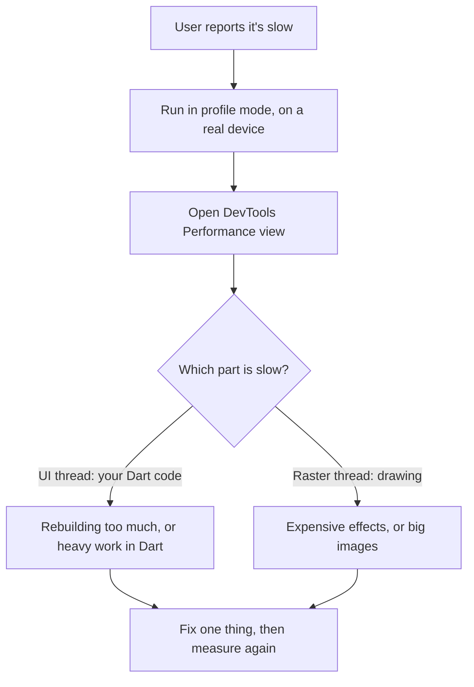

[Guide home](../README.md) · Back: [12 Testing](12-testing.md) · Next: [14 Animation Theme and Accessibility](14-animation-theme-and-accessibility.md)

# Performance and Debugging

**Why this matters:** "Your list is janky. What do you do?" is a favourite question, and a method matters more than a list of tips.

**See it working:** `flutter run -d windows`, then open lab 12. The code's in `lib/labs/app_labs.dart`.

---

# Part 1: Learn

## 1. The budget

| Screen | Time per frame |
|---|---|
| 60 Hz | 16 ms |
| 120 Hz | About 8 ms |

Each frame needs building on the UI thread, and rendering on the raster thread. So aim for about 8 ms each at 60 Hz. Miss it and you get **jank**, a visible stutter.

## 2. The method: measure first

> **Don't guess. Measure, fix the biggest problem, and measure again.**



**Why profile mode?** Debug mode is slow on purpose, so its numbers mean nothing. Use a real device, ideally a cheap one, because emulators don't support profile mode.

```powershell
flutter run --profile
```

## 3. Too many rebuilds

`build` runs often, so keep it cheap. When a widget rebuilds, its children rebuild too, unless Flutter can reuse them.

| Fix | Why it helps |
|---|---|
| Use `const` widgets | Flutter skips rebuilding the same instance. You proved this in note 05 |
| Call `setState` low in the tree | Rebuilds less |
| Split big widgets into small **classes** | Each rebuilds separately |
| Use `context.select`, `buildWhen` or `ValueListenableBuilder` | Only rebuild what's changed |
| Pass an unchanging subtree as `child` | It's built once, and reused |

**Why a widget class, rather than a helper method?**

```dart
// Helper method: part of the parent's build, so it always rebuilds with it
Widget _buildHeader() => const Text('Header');

// Widget class: gets its own element, can be const, and can skip rebuilding
class Header extends StatelessWidget {
  const Header({super.key});

  @override
  Widget build(BuildContext context) => const Text('Header');
}
```

**Don't override `==` on widgets.** It can make rebuilds much slower.

## 4. Long lists

| Fix | Why it helps |
|---|---|
| `ListView.builder` | Only builds what's visible |
| Set `itemExtent` or `prototypeItem` when items are the same height | Scrolling needs less measuring |
| Avoid `shrinkWrap` on long lists | It measures everything |
| Paginate | Don't load 10,000 rows at once |

## 5. Heavy work

Move it off the UI isolate, as you learned in [04 Dart Async](04-dart-async.md):

```dart
// Freezes: runs on the UI isolate
setState(() => _result = 'Blocked UI: ${slowSum(10000000000)}');

// Smooth: runs on another isolate
final value = await compute(slowSum, 10000000000);
```

`compute` needs a **top-level or static function**, as a method would drag its whole object along. Good candidates are large JSON parsing and image processing.

## 6. Images

| Fix | Why it helps |
|---|---|
| Set `cacheWidth` and `cacheHeight` | Don't decode a 4000 px photo for a 100 px thumbnail |
| Use `cached_network_image` | Avoid downloading twice |
| Compress assets | Smaller app, less memory |

## 7. Expensive drawing

Some effects use `saveLayer`, which draws to an offscreen buffer first. That's slow, especially in animations.

| Avoid | Prefer |
|---|---|
| `Opacity` in an animation | `AnimatedOpacity`, `FadeTransition`, or a semi-transparent color |
| `Clip.antiAliasWithSaveLayer` | Default clipping, or `borderRadius` |
| Rebuilding a whole subtree on each tick | The `child` parameter of `AnimatedBuilder` |

**`RepaintBoundary`** puts a widget on its own layer, so repainting it doesn't repaint its neighbours. Use it on something that animates constantly next to something static. It uses extra memory, so measure before and after.

## 8. Memory leaks

A **leak** is memory that can't be freed, as something still refers to it. The garbage collector can't help if a reference still exists.

Common causes: controllers not disposed, listeners not removed, subscriptions not cancelled, and large objects kept in global variables.

**Find them:** the DevTools Memory view. Take a snapshot, open and close a screen several times, and take another. If objects keep growing, you've got a leak.

## 9. App size

- Measure with `flutter build appbundle --analyze-size`.
- Use an app bundle, rather than a universal APK.
- Compress images, and remove unused packages and fonts.
- Use deferred loading if your app is big, so that parts download only when needed.

## 10. Startup time

Keep `main()` and the first screen light. Load non-essential things after the first frame, and show a splash screen if you need to.

## 11. DevTools

When your app is running, the terminal prints a link. Open it in a browser.

| Tab | Use it to |
|---|---|
| **Inspector** | See the widget tree, and fix layout problems |
| **Performance** | Find slow frames |
| **CPU Profiler** | See which function is slow |
| **Memory** | Find leaks |
| **Network** | See API calls |
| **Logging** | See logs and events |
| **App Size** | See what's making the app large |

## 12. Debugging tools

| Tool | Use it to |
|---|---|
| Breakpoints in VS Code (`F5`, click beside a line number) | Pause and inspect values |
| `debugPrint` | Print long logs without losing lines |
| `assert` | Check assumptions in debug only |
| `debugPaintSizeEnabled = true` | See layout boxes |

Catching every error, so that you can report it:

```dart
FlutterError.onError = (details) { /* report framework errors */ };
PlatformDispatcher.instance.onError = (error, stack) {
  /* report async errors */
  return true;
};
```

In production, send these to a service like Crashlytics or Sentry.

**Reading a stack trace.** When something crashes, the terminal prints a **stack trace**: the chain of function calls that led there. Most recent comes first. Don't read all of it. **Find the first line that mentions your own file**, as lines from Flutter's code usually aren't the cause. For a crash in production, Crashlytics gives you the same trace, along with the device, OS and app version.

## 13. Errors you must recognise

| Error | Meaning | Fix |
|---|---|---|
| `setState() called after dispose()` | A late callback ran after the screen closed | Check `mounted`, and cancel timers |
| `setState() or markNeedsBuild() called during build` | You changed state while drawing | Move it to a callback, or `addPostFrameCallback` |
| `Null check operator used on a null value` | `!` on a null | Handle null properly |
| `Looking up a deactivated widget's ancestor` | Using `context` after the widget left | Check `context.mounted` after `await` |
| `MissingPluginException` | No native code answered | Do a full restart after adding a plugin |
| `LateInitializationError` | A `late` value read before it's set | Set it first |

`addPostFrameCallback` runs code just after the current frame:

```dart
WidgetsBinding.instance.addPostFrameCallback((_) {
  if (mounted) setState(() => _ready = true);
});
```

---

# Part 2: Code along: speed up My Tasks

Keep working in `lib/my_app/main.dart`.

**Step 1: Parse JSON in the background.** Add this import:

```dart
import 'package:flutter/foundation.dart';
```

In `ApiTaskRepository.fetchTasks`, change the decode line:

```dart
final tasks = await compute(decodeTasks, response.body);
```

`decodeTasks` is already top-level, which is what `compute` needs. With 15 tasks this makes no real difference, but with a big response it's what stops the freeze.

**Step 2: See rebuilds happen.** Add a `print('TaskTile build: ${task.title}')` inside a new `TaskTile` widget. Move each row out into its own class, as the last stage used `CheckboxListTile` directly:

```dart
class TaskTile extends StatelessWidget {
  const TaskTile({super.key, required this.task, required this.onToggle});

  final Task task;
  final VoidCallback onToggle;

  @override
  Widget build(BuildContext context) {
    print('TaskTile build: ${task.title}');
    return CheckboxListTile(
      title: Text(task.title),
      value: task.done,
      onChanged: (_) => onToggle(),
    );
  }
}
```

Use it in the `ListView.builder`:

```dart
itemBuilder: (context, index) => TaskTile(
  key: ValueKey(tasks[index].id),
  task: tasks[index],
  onToggle: () => viewModel.toggle(tasks[index].id),
),
```

Press `R`, and tick one task. **Every visible row prints**, as the whole list rebuilds. For a small list that's fine, and that's an honest answer in an interview too: **don't optimise until you've measured.**

**Step 3: Notice the title.** The `AppBar` title has its own `ListenableBuilder`, so it only rebuilds itself, rather than the whole page. That's already an optimisation.

**Step 4: Look at it in DevTools.**

- [ ] Open the DevTools link from the terminal.
- [ ] Open **Performance**, and scroll the list.
- [ ] Open **Inspector**, and click a row to see its widget tree.
- [ ] Open **Network**, then press `R`. You can see the API call.

**Compare with:** `lib/workbook_answers/tasks_app/stage11.dart`

---

# Part 3: Workbook

**Open:** `lib/workbook/w13.dart`

**Check:** `flutter test workbook_test/w13_test.dart`

- [ ] 1 `FastCounter`: **the test counts rebuilds, so a slow answer really fails**
- [ ] 2 `sumJsonInBackground`: `compute`
- [ ] 3 `HugeList`: a list of 100,000 rows

---

# Part 4: Break it on purpose

- [ ] **Lab 12:** press the first button. The spinner **freezes** for a few seconds. Press the second button, and it keeps turning. That's the lesson on isolates.
- [ ] In `lib/main.dart`, add `debugPaintSizeEnabled = true;` as the first line in `main`, and import `package:flutter/rendering.dart`. Press `R`, and see the layout lines. Then remove it.
- [ ] Set a breakpoint in `_FormLabState._submit`. Run with `F5`. Press Submit, and inspect the values.
- [ ] In workbook 13, change your `FastCounter` to use `setState`, and pass a non-const child. Watch the test catch it.

---

# Part 5: Test yourself

<details>
<summary>Your app is janky. What do you do?</summary>

I don't guess. I run it in profile mode on a real, lower-end device, and open DevTools Performance. I check whether the UI or raster thread is over budget. For UI, I look for excess rebuilds or heavy work, and use `const`, smaller widgets, or an isolate. For raster, I look for expensive effects and oversized images. I fix one thing, then measure again.

</details>

<details>
<summary>Why does <code>const</code> improve performance?</summary>

A `const` widget is one shared instance. When Flutter sees the same instance as before, it skips rebuilding it and everything below it.

</details>

<details>
<summary>Why a widget class, rather than a helper method?</summary>

A helper method runs as part of the parent's `build`, so everything rebuilds together. A separate widget class gets its own element, can be `const`, and can skip rebuilding.

</details>

<details>
<summary>How do you optimise a long list?</summary>

Use `ListView.builder`, so only visible items get built. Give fixed item heights when possible, use `const` widgets, resize images, and paginate data. I'd avoid `shrinkWrap`, and use keys if items can reorder.

</details>

<details>
<summary>What does RepaintBoundary do?</summary>

It gives a subtree its own paint layer. Repainting it no longer repaints what's around it. It's useful for something that animates often next to static content. It uses extra memory, so measure before and after.

</details>

<details>
<summary>Why should you measure in profile mode?</summary>

Debug mode includes extra checks, and uses JIT compilation, so it runs much slower than release. Profile mode performs close to release, and still connects to DevTools.

</details>

<details>
<summary>How do you find a memory leak?</summary>

Use the DevTools Memory view. Take a snapshot, repeat an action like opening and closing a screen, and compare. Growing objects are likely leaks. The usual causes are things not disposed.

</details>

<details>
<summary>Why is <code>Opacity</code> expensive?</summary>

It can draw its child to a separate offscreen layer. Animating it is especially costly. `AnimatedOpacity` or `FadeTransition` are better, and for simple shapes, a semi-transparent color is cheaper.

</details>

<details>
<summary>How do you reduce app size?</summary>

Measure it with `--analyze-size` first. Ship an app bundle, compress images, remove unused packages and fonts, and use deferred loading for rarely used features.

</details>

<details>
<summary>What's <code>setState() called after dispose()</code>, and how do you fix it?</summary>

A callback tried to update a screen that has already closed, usually after an `await` or a timer. Check `mounted` first, and cancel timers and subscriptions in `dispose`.

</details>

<details>
<summary>What does <code>addPostFrameCallback</code> do?</summary>

It runs code just after the current frame finishes. It's useful for things that can't happen during `build`, such as showing a dialog as soon as a screen appears, or fixing `setState called during build`.

</details>

# Done when

- [ ] You can give the jank answer as a method, not a list of tips
- [ ] You saw the freeze with your own eyes
- [ ] You opened DevTools, and looked at your own app
- [ ] All 3 workbook tests pass

Next: [14 Animation Theme and Accessibility](14-animation-theme-and-accessibility.md)
