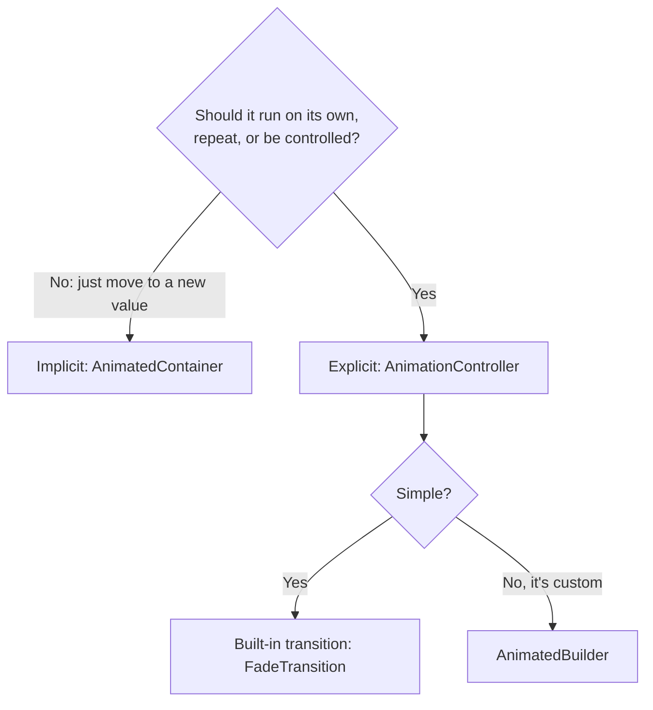

[Guide home](../README.md) · Back: [13 Performance and Debugging](13-performance-and-debugging.md) · Next: [15 Native Packages and Release](15-native-packages-and-release.md)

# Animation, Theme and Accessibility

**Why this matters:** these are smaller topics, but they come up often. Learn the main idea of each.

**See it working:** `flutter run -d windows`, then open lab 11. The code's in `lib/labs/ui_labs.dart`.

---

# Part 1: Learn

## 1. Which kind of animation?



## 2. Implicit: the easy way

Change a value, and Flutter animates to it. You don't manage anything.

```dart
AnimatedContainer(
  duration: const Duration(milliseconds: 400),
  curve: Curves.easeInOut,
  width: _big ? 180 : 80,
  height: 80,
  color: _big ? Colors.teal : Colors.orange,
)
```

Others include `AnimatedOpacity`, `AnimatedPadding`, `AnimatedAlign`, and `AnimatedSwitcher`, which animates between two different widgets. `TweenAnimationBuilder` does this for any value.

## 3. Explicit: you hold the controls

Use this when an animation must repeat, reverse, or follow a gesture.

```dart
class _AnimationLabState extends State<AnimationLab>
    with SingleTickerProviderStateMixin {
  late final AnimationController _spin = AnimationController(
    vsync: this,
    duration: const Duration(seconds: 2),
  )..repeat();

  @override
  void dispose() {
    _spin.dispose(); // forget this and the ticker keeps running
    super.dispose();
  }
}
```

| Term | Simple meaning |
|---|---|
| `AnimationController` | The timer, from 0 to 1. It can `forward`, `reverse`, `repeat` and `stop` |
| `Tween` | Turns 0 to 1 into your values, like 80 to 180 |
| `Curve` | The feel: speed up, slow down, bounce |
| `vsync` / `Ticker` | Syncs with the screen, and pauses when off-screen |
| `SingleTickerProviderStateMixin` | Provides the ticker for one controller. Use `TickerProviderStateMixin` for several |

**Using a Tween:**

```dart
late final Animation<double> _size =
    Tween<double>(begin: 80, end: 180).animate(_controller);
```

**Drawing it**, using `AnimatedBuilder`:

```dart
AnimatedBuilder(
  animation: _spin,
  child: const FlutterLogo(size: 60), // built once and reused
  builder: (context, child) => Transform.rotate(
    angle: _spin.value * 2 * pi,
    child: child,
  ),
)
```

Or use a ready-made transition: `FadeTransition`, `ScaleTransition`, `SlideTransition`, `RotationTransition`.

## 4. Hero

Flies a widget from one screen to the next. Wrap it on **both** screens, with the same `tag`:

```dart
Hero(tag: 'profile', child: ...)
```

## 5. Theme

Set your colors and text in one place, and read them anywhere:

```dart
MaterialApp(
  theme: ThemeData(colorSchemeSeed: Colors.indigo),
  darkTheme: ThemeData(
    colorSchemeSeed: Colors.indigo,
    brightness: Brightness.dark,
  ),
)
```

```dart
final colors = Theme.of(context).colorScheme;
Container(color: colors.primary);
```

`themeMode` picks light, dark or the system setting. Avoid hard-coded colors, because they break dark mode.

`colorSchemeSeed` generates a whole palette from one color.

**Material and Cupertino:** Material is Google's design system. Cupertino is the iOS style. Both are moving out of the Flutter framework, into the packages `material_ui` and `cupertino_ui`. See [16 Whats New in 2026](16-whats-new-in-2026.md).

**Showing the right style on each platform:** check `Theme.of(context).platform`, or use a `.adaptive` constructor such as `Switch.adaptive`.

## 6. Accessibility

Accessibility means everyone can use your app, including people who use screen readers or need larger text.

| Check | How |
|---|---|
| **Screen readers** | Give meaning with `Semantics(label: ...)`, `tooltip`s and image labels. Test with **TalkBack** on Android, and **VoiceOver** on iOS |
| **Text scaling** | Don't use fixed-height text boxes, and test with large text |
| **Contrast** | Text has to stand out from its background |
| **Tap targets** | At least 48 by 48 |
| **Reduced motion** | Respect the system setting |

```dart
Semantics(label: 'Profile photo', child: Image.network(url))
```

You can test it automatically, inside a widget test:

```dart
await expectLater(tester, meetsGuideline(textContrastGuideline));
```

## 7. Translation

Flutter's built-in approach: put text in `.arb` files, one per language, then generate code from them:

```dart
Text(AppLocalizations.of(context)!.helloWorld)
```

You must also set `generate: true` in `pubspec.yaml`, and add `l10n.yaml`. **Internationalization (i18n)** means making an app ready for many languages. **Localization (l10n)** is adding each one.

---

# Part 2: Code along: polish My Tasks

Keep working in `lib/my_app/main.dart`.

**Step 1: Add dark mode.** In `MyTasksApp`, add a `darkTheme`:

```dart
    return MaterialApp(
      title: 'My Tasks',
      theme: ThemeData(colorSchemeSeed: Colors.indigo),
      darkTheme: ThemeData(
        colorSchemeSeed: Colors.indigo,
        brightness: Brightness.dark,
      ),
      home: TasksScreen(viewModel: viewModel),
    );
```

Press `r`. Set your Windows theme to dark, and the app follows it.

**Step 2: Animate finished tasks.** Replace `TaskTile.build`, reading its color from the theme:

```dart
  @override
  Widget build(BuildContext context) {
    final colors = Theme.of(context).colorScheme;
    return AnimatedContainer(
      duration: const Duration(milliseconds: 300),
      color: task.done ? colors.primaryContainer : Colors.transparent,
      // A ListTile draws its tap effects on the nearest Material. Without this
      // one, the container's color would hide them.
      child: Material(
        type: MaterialType.transparency,
        child: CheckboxListTile(
          title: Text(task.title),
          value: task.done,
          onChanged: (_) => onToggle(),
        ),
      ),
    );
  }
```

Press `r`, and tick a task. The color fades in, and you only changed one value.

**Why the `Material`?** I found this with a test. Without it, Flutter reports `ListTile background color or ink splashes may be invisible`, as a colored box sits above the surface where the ripple is drawn. Try removing it, and run your tests from note 12.

**You've now finished My Tasks.** Compare with `lib/workbook_answers/tasks_app/stage11.dart`.

**Now change it yourself:**

- [ ] Change the duration to 2 seconds, and the curve to `Curves.bounceOut`.
- [ ] Add a button that switches between light and dark, using `themeMode`.
- [ ] Add a `Semantics` label to a row.

---

# Part 3: Workbook

**Open:** `lib/workbook/w14.dart`

**Check:** `flutter test workbook_test/w14_test.dart`

- [ ] 1 `FadeBox`: `AnimatedOpacity`
- [ ] 2 `Pulse`: `AnimationController`, the mixin, `ScaleTransition`, `dispose`. **Write this one from memory if you can**
- [ ] 3 `buildLightTheme` and `buildDarkTheme`
- [ ] 4 `BrandBox`: reading a theme color
- [ ] 5 `LabelledIcon`: `Semantics`

---

# Part 4: Break it on purpose

- [ ] **Lab 11:** press Toggle. Change `milliseconds: 400` to `2000`, and press `r`.
- [ ] Change `Curves.easeInOut` to `Curves.bounceOut`, and press `r`.
- [ ] Remove the `..repeat()`, and press `R`. The logo doesn't spin.
- [ ] Remove `with SingleTickerProviderStateMixin`. It won't compile, as `this` no longer works for `vsync`.

---

# Part 5: Test yourself

<details>
<summary>Implicit vs explicit animations?</summary>

Implicit ones animate automatically when a value changes, like `AnimatedContainer`, and are very simple. Explicit ones use an `AnimationController` that you control, so they can repeat, reverse, or be driven by gestures. I start with implicit, and use explicit when I need control.

</details>

<details>
<summary>What's <code>vsync</code> for?</summary>

It connects the controller to a `Ticker`, which fires once per frame. It keeps animations in sync with the screen, and pauses them when the widget isn't visible, which saves battery.

</details>

<details>
<summary>What's a Tween?</summary>

It maps the controller's 0 to 1 range onto real values, such as sizes or colors. A Curve changes the speed along the way.

</details>

<details>
<summary>Why pass <code>child</code> to <code>AnimatedBuilder</code>?</summary>

That part gets built once and reused on every frame, rather than being rebuilt 60 times a second. It's a simple performance win.

</details>

<details>
<summary>How do you support dark mode?</summary>

Set both `theme` and `darkTheme` on `MaterialApp`, use `themeMode`, and read colors from `Theme.of(context).colorScheme` rather than hard-coding them.

</details>

<details>
<summary>How do you make a Flutter app accessible?</summary>

Add semantic labels for screen readers, support larger text without breaking layouts, keep good contrast, and use tap targets of at least 48 by 48. I test with TalkBack or VoiceOver, and can add guideline checks to widget tests.

</details>

<details>
<summary>How do you translate a Flutter app?</summary>

Put the text in `.arb` files, one for each language, turn on generation, and read strings through the generated `AppLocalizations` class.

</details>

# Done when

- [ ] You can choose between implicit and explicit
- [ ] You can write an AnimationController with `dispose` from memory
- [ ] You can name four accessibility checks
- [ ] My Tasks has dark mode and an animation, built by you

Next: [15 Native Packages and Release](15-native-packages-and-release.md)
