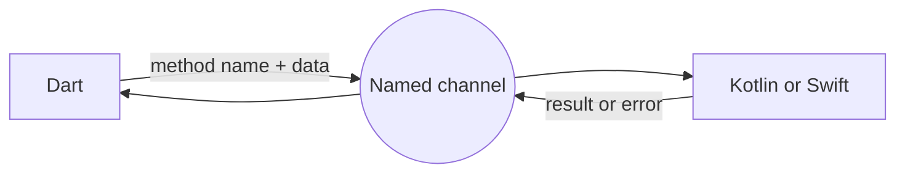
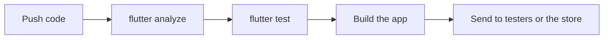

[Guide home](../README.md) · Back: [14 Animation Theme and Accessibility](14-animation-theme-and-accessibility.md) · Next: [16 Whats New in 2026](16-whats-new-in-2026.md)

# Native Code, Packages and Release

**Why this matters:** this shows you've thought about shipping real apps, and not just running them on your own machine.

**See it working:** `flutter run -d windows`, then open lab 13. The code's in `lib/labs/app_labs.dart`.

---

# Part 1: Learn

## 1. Talking to native code

Flutter can't reach everything by itself, such as a vendor's SDK or a sensor. A **platform channel** is like a phone line between Dart and native code.



It's asynchronous, so Dart gets back a `Future`. Values are converted automatically: a Dart `Map` becomes a `HashMap` in Kotlin, or a `Dictionary` in Swift.

**The Dart side:**

```dart
static const _channel = MethodChannel('lab/battery');

try {
  final level = await _channel.invokeMethod<int>('getBatteryLevel');
} on MissingPluginException {
  // no native code answered
} on PlatformException catch (e) {
  // the native side reported an error
}
```

**The Android side, in Kotlin.** The channel name must match exactly:

```kotlin
MethodChannel(flutterEngine.dartExecutor.binaryMessenger, "lab/battery")
    .setMethodCallHandler { call, result ->
        if (call.method == "getBatteryLevel") result.success(80)
        else result.notImplemented()
    }
```

| Tool | Use it for |
|---|---|
| `MethodChannel` | One call, one answer |
| `EventChannel` | A continuous stream from native, such as sensors |
| `BasicMessageChannel` | Simple messages in both directions |
| `Pigeon` | Generates type-safe channel code, so you avoid typos |
| `dart:ffi` | Calling C libraries directly and quickly |
| Platform views | Showing a native widget inside Flutter, like a map |

## 2. Packages

| | Package | Plugin |
|---|---|---|
| Contains | Dart only | Dart **and** native code |
| Example | `provider` | `shared_preferences` |
| After adding | Hot restart may do | **Needs a full restart** |

## 3. pubspec.yaml

This is the project's config file: name, version, dependencies, assets and fonts.

```yaml
name: my_app
version: 1.2.3+45   # the version users see + an internal build number

environment:
  sdk: ^3.13.7

dependencies:
  http: ^1.6.0      # any 1.x from 1.6.0, but not 2.0.0

dev_dependencies:
  mocktail: ^1.0.5  # only for development, not shipped

flutter:
  assets:
    - assets/photo.png
```

| File or command | Meaning |
|---|---|
| `^1.6.0` | At least 1.6.0, but below 2.0.0 |
| `pubspec.lock` | The exact versions used. **Commit it for apps** |
| `flutter pub add http` | Adds a package |
| `flutter pub get` | Installs packages |
| `flutter pub outdated` | Shows what's old |
| `flutter pub upgrade` | Updates within your limits |

**Why stop at the next major version?** By convention, a major version change (`2.0.0`) can break your code. This is called **semantic versioning**: major.minor.patch.

**How to choose a package:** check how recently it was updated, pub points, likes, a verified publisher, platform support, and whether the issue tracker is active. Fewer dependencies is better. Keeping third-party code behind your own interface makes it easy to replace.

## 4. Build and release

| Platform | Command | Notes |
|---|---|---|
| Android | `flutter build appbundle` | Play Store format. Needs signing with your keystore |
| iOS | `flutter build ipa` | Needs a Mac, Xcode, and an Apple developer account |
| Web | `flutter build web` | Add `--wasm` for WebAssembly |
| Windows | `flutter build windows` | |

**Releasing an Android app, step by step:**

1. Set the app name, icon and `applicationId`.
2. Set the version in `pubspec.yaml`.
3. Create a keystore, and configure signing.
4. Build: `flutter build appbundle`.
5. Upload to the Play Console.
6. Go through internal and closed testing.
7. Roll out gradually.

> [!CAUTION]
> **Android signing**
>
> Keep your keystore and its passwords **out of Git**, and back them up safely. They identify you as the app's owner.

## 5. Environments and flavors

**Flavors** let you make separate dev, staging and production builds from the same code, with different server URLs, icons and app IDs. They can be installed side by side.

```powershell
flutter run --flavor dev --dart-define=API_URL=https://dev.example.com
```

```dart
const apiUrl = String.fromEnvironment('API_URL');
```

## 6. CI/CD

**Continuous integration** runs your checks automatically. **Continuous delivery** builds and ships automatically.



Common tools: GitHub Actions, Codemagic, Bitrise and Fastlane.

## 7. After release

Track crashes and usage with Firebase Crashlytics or Sentry, and analytics. Roll out to a small percentage of users first.

## 8. Security

| Risk | What to do |
|---|---|
| API keys in the app | **Anyone can extract them.** Keep real secrets on your server |
| `--dart-define` values | Not secret either. They're inside the built app |
| Stored tokens | Use `flutter_secure_storage` |
| Network | HTTPS only. Certificate pinning for high-risk apps |
| Reverse engineering | `--obfuscate` makes it harder, not impossible |
| Bad dependencies | Keep packages updated, and check who publishes them |

**Certificate pinning** means the app only trusts your server's specific certificate, which blocks some attacks that intercept traffic.

> [!TIP]
> **A real example**
>
> Flutter 3.47.8 blocked some compromised certificate authority keys. Using 3.47.8 or later matters, and it shows that keeping your SDK up to date is a security issue.

## 9. Firebase, quickly

| Service | Job |
|---|---|
| Authentication | Logins |
| Firestore | Cloud database with live updates |
| Cloud Messaging (FCM) | Push notifications |
| Crashlytics | Crash reports |
| Remote Config | Change app settings without a release |
| Analytics | Usage data |

**Push notifications:** get the device token, send it to your server, ask for permission (on iOS and recent Android), and handle messages in the foreground, background and when the app is closed. Tapping one should deep link to the right screen.

---

# Part 2: Hands on

**Step 1: See a channel fail safely.**

- [ ] **Lab 13:** press "Call native". It reports that no native code answered, on purpose. That's `MissingPluginException` being handled.

**Step 2: Write a real platform channel.** Your project has an Android folder, but you may not have an Android device set up, so read this instead of running it.

- [ ] Open `android/app/src/main/kotlin/.../MainActivity.kt`, and find where the Kotlin code above would go.
- [ ] Open `android/app/build.gradle.kts`. Find `applicationId`, `minSdk` and the signing config.
- [ ] Open `android/app/src/main/AndroidManifest.xml`. This is where Android permissions go.

**Step 3: Run real commands on your project.**

```powershell
flutter pub outdated
flutter pub deps
flutter build windows --release
```

- [ ] Look at what `pub outdated` reports.
- [ ] Find your built app in `build\windows\x64\runner\Release`, and run it. That's a release build, which is noticeably quicker.

**Step 4: Add an asset to My Tasks.**

- [ ] Create an `assets` folder, and put an image in it.
- [ ] Declare it in `pubspec.yaml`.
- [ ] Show it using `Image.asset` on the empty state. Do a full restart.

**Step 5: Read a value at build time.**

- [ ] In My Tasks, add `const label = String.fromEnvironment('LABEL', defaultValue: 'My Tasks');`, and use it as the title.
- [ ] Run it with `flutter run -d windows -t lib/my_app/main.dart --dart-define=LABEL=Staging`.

---

# Part 3: Workbook

**Open:** `lib/workbook/w15.dart`

**Check:** `flutter test workbook_test/w15_test.dart`

- [ ] 1 `BatteryService`: `MethodChannel`, with error handling. The test pretends to be the native side
- [ ] 2 `parseVersion`: reading `1.2.3+45`
- [ ] 3 `allowsVersion`: what `^` really means

---

# Part 4: Test yourself

<details>
<summary>How does Flutter communicate with native code?</summary>

With platform channels. Dart sends a method name and data over a named channel, the native side handles it, and it returns a result asynchronously. `MethodChannel` handles single calls, and `EventChannel` handles streams. Pigeon generates type-safe code, and FFI calls C directly.

</details>

<details>
<summary>Package vs plugin?</summary>

A package is Dart only. A plugin also includes native platform code, so adding a plugin needs a full rebuild, not a hot reload.

</details>

<details>
<summary>What is <code>pubspec.yaml</code>?</summary>

The project's config file: name, version, dependencies, assets and fonts.

</details>

<details>
<summary>What does <code>^1.2.3</code> mean?</summary>

Any compatible version: at least 1.2.3, but below 2.0.0. The next major version may break things, so it's excluded.

</details>

<details>
<summary>Should <code>pubspec.lock</code> be committed?</summary>

For apps, yes, so the whole team and CI use exactly the same versions. For a package, it isn't needed in the same way, as apps using it choose their own versions.

</details>

<details>
<summary>What are the steps to release an Android app?</summary>

Set the version and app ID, create a keystore and configure signing, build with `flutter build appbundle`, upload it to the Play Console, go through testing tracks, and roll out gradually.

</details>

<details>
<summary>What are flavors for?</summary>

Building different versions from one codebase, such as dev, staging and production. Each can have a different server, icon and app ID, and they can be installed side by side.

</details>

<details>
<summary>How do you store an API key safely?</summary>

Anything in the app can be extracted, including `--dart-define` values and obfuscated code. Real secrets belong on a server, and the app calls that server. Client-side keys have to be restricted by app and usage.

</details>

<details>
<summary>What would your CI pipeline do?</summary>

On each pull request: check formatting, run `flutter analyze` and `flutter test`. On merge: build and sign, and send to testers. Releases then roll out in stages.

</details>

<details>
<summary>How do you implement push notifications?</summary>

Usually with Firebase Cloud Messaging. Get the device token, send it to your server, request permission on iOS and recent Android, and handle messages in foreground, background and when the app is closed. Tapping one should deep link to the right screen.

</details>

# Done when

- [ ] You can explain MethodChannel, and read the Kotlin example
- [ ] You know package vs plugin, and what `^` means
- [ ] You can list the Android release steps
- [ ] You made a release build of your own project

Next: [16 Whats New in 2026](16-whats-new-in-2026.md)
